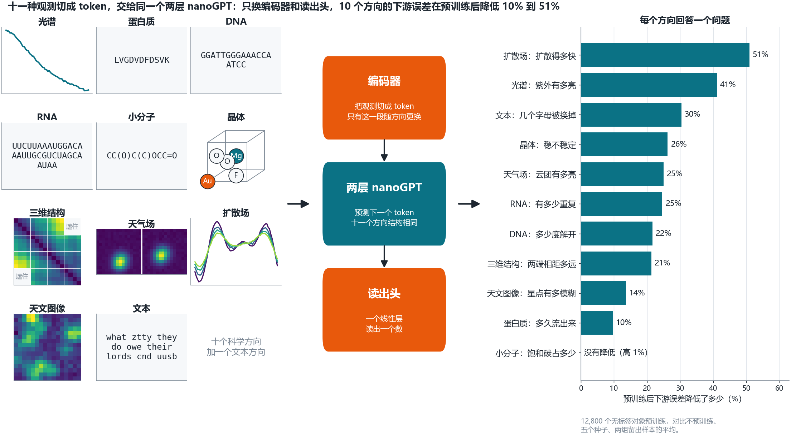
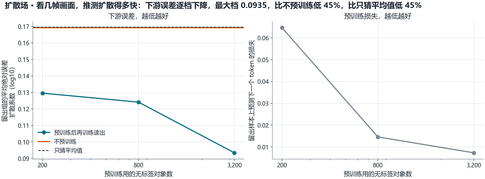
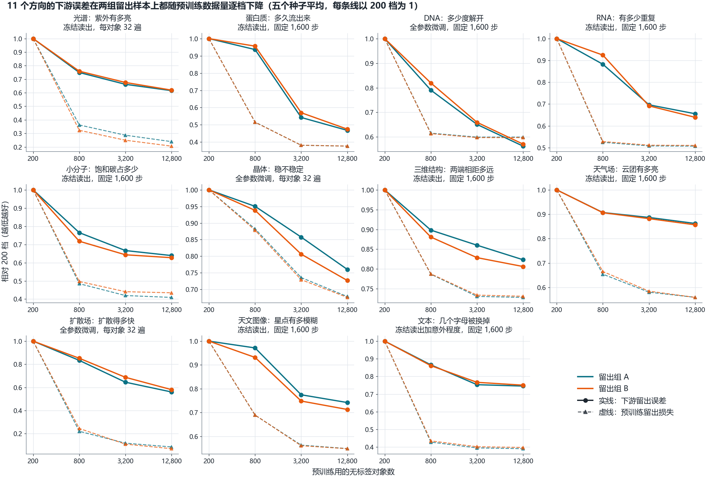

# nanoSciGPT

“科学模型专题实训（二）：如何构建领域基座模型与 AI Scientist 系统”的配套代码、数据和教学 Skill。

**V2 定稿（2026-11-27）**：十一个方向的标签、数据来源和“同一个主干、只换编码器和读出”的口径已逐项复核，结论与已知限制见 [V2 复核页](docs/version-v2.md)。

这套材料的目标是展示一种教学可能性：把不同科学观测写成 token，交给同一个 nanoGPT，让学员看到预训练数据量增加时下游误差怎么变。它不是各领域的真实基准。十个科学方向里有五个是公式生成的理想化模拟，用来隔离变量、控制难度和 CPU 用时；它们的适用范围和“不是什么”写在[数据来源页](data/eleven/SOURCES.md#模拟数据指什么)。真实数据上的精度要另做验证。



## 三分钟上手

需要 Python 3.10 及以上和 Git，只用 CPU。

```bash
git clone https://github.com/Yu-Yang-Li/nanoSciGPT.git
cd nanoSciGPT
python -m pip install torch --index-url https://download.pytorch.org/whl/cpu
python -m pip install -e .
python -m nanoscigpt.quickstart
```

最后一条命令用扩散场跑一遍完整流程：200、800、3,200 个无标签对象各预训练一次，再用 32 个标签训练下游读出，约半分钟。它打印每一档的留出误差，并把结果图存成 `quickstart-field.png`：



换方向在命令后面加名字，例如 `python -m nanoscigpt.quickstart protein`。前两条安装命令的用时取决于网络，实测见 [首次使用检查](docs/first-run.md)。想一步一步看数据、token、模型和训练，打开 [Notebook](notebooks/eleven_fields.ipynb)，见下面的“怎么装、怎么跑”。

## 科学语言

**科学语言**是这个项目的出发点。语言模型读的是一串 token，学的是根据前面的 token 预测下一个。光谱、氨基酸序列、晶胞、天气图、星场图像也可以写成一串 token：光谱每 4 个相邻波长的通量算一个 token，蛋白质每个氨基酸算一个，晶体先放晶格、再放每个原子。写成 token 之后，十一种科学观测都交给同一个两层的 nanoGPT，用同一个目标预训练：预测下一个 token。方向不同，只换把观测切成 token 的编码器，以及最后读出一个数的线性头。

| 方向 | 数据 | 要回答的问题 | 标签怎么来的 | 一个 token 是什么 |
|---|---|---|---|---|
| 光谱 | 模拟 | 看可见光部分，推测紫外有多亮 | 模拟设定 | 连续 4 个波长采样点的通量 |
| 蛋白质 | 真实 | 预测蛋白质片段在仪器里多久流出来 | 实验测的 | 1 个氨基酸 |
| DNA | 真实 | 预测一小段 DNA 加热到多少度会解开 | 实验测的 | 1 个碱基 |
| RNA | 真实 | 判断一段序列的局部组成有多复杂 | 直接数出来的 | 1 个碱基 |
| 小分子 | 真实分子 | 预测分子里饱和碳占多少 | 由结构式算出来的 | 1 个 SMILES 词法单元，如 `[nH]`、`[NH3+]` |
| 晶体 | 计算数据 | 预测晶体稳不稳定 | 量子力学计算 | 晶格矩阵占 1 个，之后每个原子 1 个 |
| 三维结构 | 模拟 | 根据部分原子间的距离，推测分子链两端相距多远 | 模拟设定 | 原子间距离矩阵中的 1 个 4×4 块 |
| 天气场 | 简化模拟 | 看几帧亮斑移动的画面，估计亮斑有多亮 | 模拟设定 | 同一 4×4 区域的连续四帧 |
| 扩散场 | 模拟 | 看几帧画面，推测扩散得多快 | 模拟设定 | 4 个相邻位置的连续四帧 |
| 天文图像 | 模拟 | 估计星点有多模糊 | 模拟设定 | 4×4 像素块 |
| 文本 | 真实 | 一行英文里有几个字母被换掉了 | 替换时记下的 | 1 个字母或空格 |

这是一套教学演示：十个科学方向加一个文本方向，都用同一个小模型。“数据”和“标签怎么来的”两列说明每个方向的结果能代表什么。每个方向的专业定义、单位、数据范围和出处见 [数据来源与专业说明](data/eleven/SOURCES.md)。

符号类 token 查词表得到向量，数值类 token 经过一个线性层投影，晶体的原子 token 由元素向量加坐标投影组成。[编码器代码](nanoscigpt/scientific/encoders.py) · [主干](nanoscigpt/scientific/scigpt.py)

## 预训练数据越多，下游越好

每个方向用 200、800、3,200、12,800 个无标签对象各预训练一次，五个随机种子。然后从这批检查点出发，只用 32 个标签训练下游读出，在两组未参与训练的留出样本上测误差。按五种子平均计算，11 个默认下游任务在两组留出上都逐档下降（实线）。预训练留出损失在 10 个方向也逐档下降（虚线），DNA 的最后两档基本持平。



6 个方向的口径完全统一：冻结主干，只训练线性头，每档固定 1,600 次预训练更新，所以曲线只反映数据量的变化。另外 5 个方向保留了其他做法。光谱、扩散场和晶体每个对象平均训练 32 遍，数据越多训练步数越多；晶体和 DNA 用全参数微调。DNA 换成冻结读出后也能逐档下降，但 12,800 档比不预训练差约 5%，所以保留全参数微调，这时比不预训练好 21%。文本的线性头除了模型的表示，还读两个数：模型逐个预测下一个字母时平均有多意外、最意外的一处有多意外。拼写学得越熟，碰到被换掉的字母越意外。

文本原来的任务是去掉空格后数词数，误差始终和只猜均值差不多，后来换成数被换掉的字母。现在末档比只猜均值低约三成，B 组是只猜均值的 0.707 倍，比换任务时事先定的 0.7 门槛差一点。

另外三个方向比较弱，各对应一种预训练帮不上忙的情况：

- **标签少：晶体。** 预测形成能时，200 和 800 两档还不如只猜均值，到 3,200 档才超过，末档比只猜均值低约 17% 到 20%。只有 32 个标签时，不预训练的模型无论怎么读出都比只猜均值差；预训练数据也少的时候，学到的东西还不够把它拉回来。Notebook 默认的单种子三档演示里，三档都还没超过只猜均值，加上 12,800 档才超过（0.488 对 0.551）。
- **标签简单：RNA。** 三核苷酸熵可以直接从序列数出来，不预训练的模型取嵌入平均就能读出一部分，所以末档只比只猜均值好约 10%。换成要靠比对或注释才知道的量（保守程度、来自大亚基还是小亚基），32 个标签又读不出来；换成和碱基组成关系很紧的折叠自由能，又看不出预训练比不预训练好。
- **标签不对应：DNA。** 预训练读的是酵母基因组片段，下游是 14 到 18 个碱基的人工发夹，两者长度、成分、结构都对不上。基因组片段到 3,200 条以后，预训练损失基本不再下降，下游靠全参数微调还在变好。改用和发夹同一个实验的两万多条序列预训练，又因为都是少数几种骨架的变体，800 条就学完了，下游反而不如不预训练。

[逐方向数字、口径说明和全部留出结果](docs/pretraining-scale/shared-checkpoints/README.md) · [遮住晶格、扰动文本的独立复验](docs/pretraining-scale/shared-checkpoints/masked-transfer.md) · [四处偏弱方向的再打磨](docs/pretraining-scale/shared-checkpoints/weak-four/README.md)

面向公众的图文版教程在 [docs/wechat/article.md](docs/wechat/article.md)，配了封面、两条规模曲线和三个反例的图。

## 怎么装、怎么跑

**Notebook（推荐）。** [notebooks/eleven_fields.ipynb](notebooks/eleven_fields.ipynb) 是一本从头到尾的教程：开头是课程定位和结论总表，每一节写着本节目标和检查点，每格有图、有一两句说明、有可以改的参数，最后是练习、常见问题和复现说明。在第 0 节把 `FIELD` 改成想看的方向（默认 `field`，即扩散场），然后从上到下运行。只需要 CPU。

| 节 | 做什么 | 能看到什么 | 可以改的参数 |
|---|---|---|---|
| 0 | 选方向，装依赖 | 这个方向要回答的问题、数据是真实还是模拟、标签怎么来的 | `FIELD`、`SEED`、`N_LABELS`、`THREADS` |
| 1 | 看数据 | 标签偏低、居中、偏高的三条样本，标签的分布 | `N_EXAMPLES` |
| 2 | 预处理 | 同一条样本画成 token；标准化前后的数值分布 | `ROW` |
| 3 | 搭模型 | 编码器结构；和另一个方向对比每一段的参数个数 | `COMPARE_WITH` |
| 4 | 预训练 | 每一档数据量的训练曲线和留出损失 | `SIZES` |
| 5 | 下游训练 | 留出组上预测值对真实值，预训练前后对比 | `READOUT`、`COMPARE` |
| 6 | 评测 | 下游误差随预训练数据量的变化，和两条基线比；再读入五个种子的封存结果对照 | |
| 7 | 自动研究 | 存档的搜索过程和十一方向对照；现场跑一次搜索；把搜索经验带到没见过的方向 | `METHOD`、`ROUNDS`、`DEV_SEEDS` |
| 8 | 星流轨道拟合 | 轨道叠在观测点上随轮次怎么变、经验怎么改写、盲测成绩 | `SCENARIO`、`SHOW_ROUNDS`、`READ_ROUND` |
| 9 | 练习与延伸 | 换方向、换标签数、换读出方式；三个反例为什么失败；常见问题与复现说明 | `N_LABELS`、`READOUT` |

每张图上方加粗的一句话是这张图的结论，由当前的数字生成，换方向会跟着变。全部的图用同一套样式（`nanoscigpt/style.py`）：同样的字号，主角、对照、第三种方法各用固定的颜色。

第 0 节会自己安装缺少的依赖，在仓库外单独打开时会先克隆仓库。机器上没有中文字体时，它会下载一次 Noto Sans SC（约 8 MB）用来显示图里的中文。魔搭 Notebook 的镜像通常自带 torch，装依赖这一步会跳过。

依赖装好后，默认方向每一节的用时（24 核 Windows 电脑，2 个线程，机器上同时有别的任务）：看数据、切 token、搭模型共 2 秒，预训练三档 12 秒，下游训练和评测 4 秒，读自动研究和搜索经验的存档 1 秒，现场随机搜索 2 轮 1 到 4 分钟，星流的四组图 2 秒。整本约半分钟（现场搜索读的是已有记录时）。

十一个方向各把整本 Notebook 跑了一遍（三个方向同时运行），都没有报错。误差是 Notebook 里打印的数：

| 方向 | 整本用时 | 其中预训练 | 下游和评测 | 种子 53 的下游误差（200 / 800 / 3,200） | 不预训练 | 只猜均值 | 三档逐档下降 |
|---|---:|---:|---:|---|---:|---:|:---:|
| 扩散场（默认） | 266 秒 | 34 秒 | 7 秒 | 0.1296 / 0.1242 / 0.0935 | 0.1692 | 0.1696 | 是 |
| 光谱 | 263 秒 | 34 秒 | 1 秒 | 0.1115 / 0.0941 / 0.0622 | 0.1013 | 0.3301 | 是 |
| 蛋白质 | 179 秒 | 101 秒 | 1 秒 | 13.2014 / 13.9479 / 8.0208 | 8.1670 | 10.8433 | 否 |
| DNA | 308 秒 | 164 秒 | 16 秒 | 5.2613 / 5.0546 / 4.1484 | 3.6229 | 7.0323 | 是 |
| RNA | 141 秒 | 79 秒 | 1 秒 | 0.3097 / 0.2539 / 0.1691 | 0.2675 | 0.1744 | 是 |
| 小分子 | 201 秒 | 82 秒 | 1 秒 | 0.1998 / 0.1474 / 0.0917 | 0.1084 | 0.2355 | 是 |
| 晶体 | 71 秒 | 15 秒 | 3 秒 | 0.6072 / 0.5966 / 0.5595 | 0.5727 | 0.5506 | 是 |
| 三维结构 | 99 秒 | 61 秒 | 1 秒 | 0.9997 / 0.8652 / 0.8647 | 1.0549 | 2.9500 | 是 |
| 天气场 | 79 秒 | 42 秒 | 1 秒 | 0.1499 / 0.1678 / 0.1606 | 0.1540 | 0.1661 | 否 |
| 天文图像 | 80 秒 | 50 秒 | 1 秒 | 0.7082 / 0.5668 / 0.4306 | 0.5238 | 0.6250 | 是 |
| 文本 | 114 秒 | 100 秒 | 1 秒 | 2.2234 / 1.7755 / 1.7531 | 2.2878 | 2.2882 | 是 |

文本一行是 2026-11-27 换任务后单独重跑的，只跑这一个方向，现场搜索读的是已有的存档，所以整本用时比别的方向短。单个种子、单组留出、只到 3,200 档时，曲线会有起伏，上图的五种子平均才是结论依据。在 Windows 上，种子 53 的每个数都和五种子实验里同一种子的记录一致；Linux 上浮点计算顺序不同，预训练损失差 2% 以内，单种子下游误差可能差到 20% 左右。

**安装 Notebook。** 在“三分钟上手”的基础上再装 Jupyter。下面用了虚拟环境，和别的项目互不影响。

```bash
git clone https://github.com/Yu-Yang-Li/nanoSciGPT.git
cd nanoSciGPT
python -m venv .venv
.venv/bin/python -m pip install torch --index-url https://download.pytorch.org/whl/cpu
.venv/bin/python -m pip install -e ".[notebook]"
.venv/bin/python -m jupyter notebook notebooks/eleven_fields.ipynb
```

Windows 把 `.venv/bin/python` 换成 `.venv\Scripts\python.exe`。`[notebook]` 会装上 Jupyter；只用命令行时写 `pip install -e .` 就够了。不打开界面、直接整本执行：

```bash
.venv/bin/python -m jupyter nbconvert --to notebook --execute notebooks/eleven_fields.ipynb --output-dir out
```

执行后的 Notebook 存在 `out/eleven_fields.ipynb`。从空目录照这一节走一遍，Windows 和 WSL 上每一步、每一节的耗时见 [首次使用检查](docs/first-run.md)。不想运行也可以先看[执行过的版本](notebooks/eleven_fields.executed.ipynb)，它是 2026-11-27 换文本任务后在 Windows 上整本重新执行的结果，图和输出都在里面。

**命令行。** Notebook 的每一段都有对应的命令，不需要 Jupyter：

```bash
.venv/bin/python -m nanoscigpt.tasks.eleven --field field            # 第 2 到 6 节：打印 token，预训练三档，下游误差
.venv/bin/python -m autoresearch.common_search --field field --method random --rounds 2 --seeds 53   # 第 7 节：自动研究
.venv/bin/python -m autoresearch.replay_stream                       # 第 8 节：从存档参数重算星流拟合的 χ²
```

第一条命令用 `--sizes 200,800,3200,12800` 可以加到最大档，`--seed` 可以换种子。第二条命令和 Notebook 第 7 节一样，只跑 2 轮、1 个种子，几分钟看完流程；去掉 `--rounds 2 --seeds 53` 就是存档用的设置（8 轮、3 个种子打分、5 个种子评留出），扩散场要跑几十分钟。把 `--method` 换成 `model` 就由 DSK 来提改动，需要先在自己的进程环境里设置 `SCNET_API_BASE`、`SCNET_API_KEY`、`SCNET_MODEL`，密钥不写进任何文件。

## 从一次训练到自动研究，再到经验积累

- **[十一个方向用同一套自动研究](docs/autoresearch-eleven.md)**：主干固定，程序每轮提一个改动、跑实验、看开发集，8 轮后在留出组上评一次。DSK 在 7 个方向上每次运行都好于起点，按事先写定的标准在 4 个方向上好于同预算的随机搜索，5 个方向分不出高下，2 个方向没有跑赢。每个方向的对照（起点、自动研究后、随机搜索）见结果页和 Notebook 第 7 节。
- **[把搜索经验带到没见过的方向](docs/search-skill.md)**：十一个方向分成 4 折轮着留出，DSK 把其余方向的搜索记录写成一份搜索经验，锁定后带到留出的方向上，和不带经验的 DSK、随机搜索比。按事先写定的标准，没有看到经验带来的改进：带着经验的留出误差平均比不带经验低 0.9%，11 个方向里 6 个更好。
- **[扩散场上更早的两版自动研究](docs/autoresearch-field.md)**：搜索空间为扩散场单独设计，DSK 和随机搜索各跑 3 次。
- **[星流轨道拟合与调参经验积累](docs/stream-skill.md)**：DSK 边看拟合结果边调 7 个轨道参数，每轮拟合两个训练场景后改写自己的调参经验，锁定后到 8 个没见过的场景上盲测，共 8 轮。带着经验比空经验好，最好的是第 5 轮，之后回升。Notebook 第 8 节把轨道、经验的改写和盲测成绩画了出来。

## 更多

- [五种子完整实验与留出结果](docs/pretraining-scale/shared-checkpoints/README.md)，含读出方式、预算的选择规则和没有通过的任务
- [只看预训练损失的四档总表与离线复现包](docs/pretraining-scale/data-scaling/README.md)
- [课堂提问](docs/classroom-prompts.md)
- [三个教学 Skill](skills/README.md)：配合编程 Agent 做基线、预训练和研究迭代
- [早期课堂与验收记录](docs/history.md)：2026 年 9 月的光变课堂、三行对照和旧验收

## 仓库结构

```text
notebooks/eleven_fields.ipynb   教程主入口：数据、token、模型、训练、评测、自动研究、星流拟合
nanoscigpt/
  core/                         nanoGPT 主干和训练代码
  scientific/                   编码器（符号、数值块、晶胞）和 SciGPT
  tasks/eleven.py               十一个方向的数据、预训练和下游读出
  tasks/eleven_plots.py         Notebook 第 1 到 6 节的图
  style.py                      全部图共用的样式
  quickstart.py                 三分钟上手的那条命令
autoresearch/
  common_search.py              十一个方向共用的自动研究
  search_skill.py               把搜索经验写下来，带到没见过的方向
  stream_fit.py, stream_skill.py   星流轨道拟合和调参经验积累
  search_plots.py, stream_plots.py Notebook 第 7、8 节的图
data/eleven/                    六个真实数据方向的 token 小表；模拟方向运行时生成
docs/                           实验结果、课程资料和历史记录
skills/                         三个教学 Skill
tests/                          回归测试
```

## 许可与致谢

代码采用 [MIT 许可](LICENSE)。主干改编自 [karpathy/nanoGPT](https://github.com/karpathy/nanoGPT)，见 [THIRD_PARTY_NOTICES.md](THIRD_PARTY_NOTICES.md)。

真实数据的来源如下，各自许可仍然适用：

- 酵母肽段保留时间：DeepLC 数据集，[CC BY 4.0](https://doi.org/10.5281/zenodo.4542884)
- 核糖体 RNA 片段：[Rfam 15.1](https://rfam.org/downloads)，CC0
- DNA 窗口：酿酒酵母参考基因组 [sacCer3](https://hgdownload.soe.ucsc.edu/goldenPath/sacCer3/bigZips/)
- 小分子：[QM9](https://doi.org/10.6084/m9.figshare.978904)
- 晶体：[Matbench 钙钛矿](https://matbench.materialsproject.org/Leaderboards/00matbench_v0.1_matbench_perovskites/)
- 文本：Tiny Shakespeare

DNA 发夹熔解温度的出处见 [data/eleven/SOURCES.md](data/eleven/SOURCES.md)。
