# 十一个方向用同一套自动研究

[扩散场上的自动研究](autoresearch-field.md)只做了一个方向，搜索空间也是为扩散场单独写的。这里把同样的做法推广到十一个方向：同一套可改的设置、同一套流程、同一条胜负标准。代码在 `autoresearch/common_search.py`，规则在启动前写进[约定文件](autoresearch-eleven/protocol.md)。

**结论：DSK 在 7 个方向上每次运行都好于起点，按事先写定的标准在 4 个方向上好于同预算的随机搜索，5 个方向分不出高下，2 个方向没有跑赢。**

- 好于随机搜索：小分子、三维结构、天气场、天文图像。
- 和随机搜索分不出高下：光谱、蛋白质、DNA、RNA、晶体。
- 没有跑赢随机搜索：扩散场、文本。
- DSK 每次运行都好于起点：光谱、蛋白质、RNA、小分子、三维结构、天气场、天文图像。没有稳定好于起点：DNA、晶体、扩散场、文本。没有找到比起点更好的配置：没有。
- 随机搜索每次运行都好于起点的方向：光谱、文本。

改善幅度最大的是小分子，DSK 选出的配置在留出组上比起点低 30.7%。

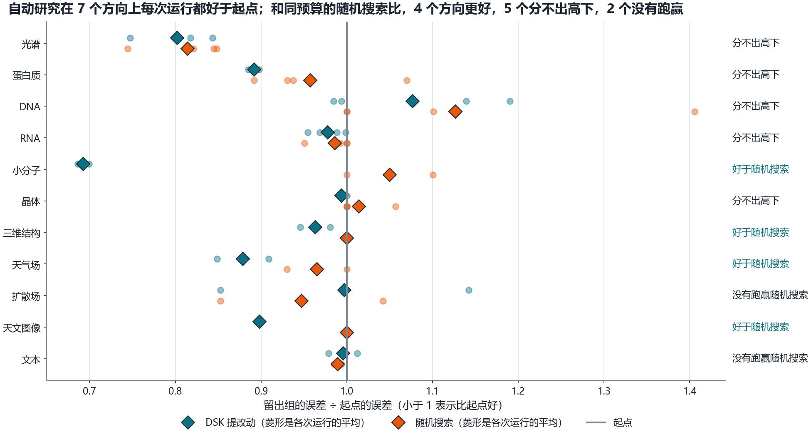

留出组 A 上的平均绝对误差，5 个种子平均。括号里是各次运行各自的数。

| 方向 | 每种方法的运行次数 | 起点 | DSK 平均（各次） | 随机搜索平均（各次） | 只猜均值 | 对起点 | 对随机搜索 |
|---|---:|---:|---:|---:|---:|---|---|
| 光谱 | 4 | 0.0652 | 0.05229（0.055、0.05211、0.0533、0.04874） | 0.0531（0.0553、0.05352、0.04853、0.05507） | 0.3257 | 好于起点 | 和随机搜索分不出高下 |
| 蛋白质 | 4 | 6.287 | 5.606（5.608、5.644、5.608、5.564） | 6.02（5.85、6.728、5.608、5.894） | 10.83 | 好于起点 | 和随机搜索分不出高下 |
| DNA | 4 | 2.975 | 3.203（2.956、2.928、3.389、3.54） | 3.351（2.975、4.181、3.275、2.975） | 7.068 | 没有稳定好于起点 | 和随机搜索分不出高下 |
| RNA | 4 | 0.1555 | 0.1521（0.1507、0.1553、0.1485、0.1537） | 0.1533（0.1544、0.1555、0.1479、0.1555） | 0.161 | 好于起点 | 和随机搜索分不出高下 |
| 小分子 | 2 | 0.1147 | 0.07948（0.08024、0.07871） | 0.1205（0.1263、0.1147） | 0.228 | 好于起点 | 好于随机搜索 |
| 晶体 | 4 | 0.4673 | 0.4644（0.4635、0.4635、0.4673、0.4635） | 0.4739（0.4673、0.4938、0.4673、0.4673） | 0.5641 | 没有稳定好于起点 | 和随机搜索分不出高下 |
| 三维结构 | 2 | 0.8307 | 0.8（0.8144、0.7857） | 0.8307（0.8307、0.8307） | 2.859 | 好于起点 | 好于随机搜索 |
| 天气场 | 2 | 0.1242 | 0.1091（0.1054、0.1129） | 0.1199（0.1155、0.1242） | 0.164 | 好于起点 | 好于随机搜索 |
| 扩散场 | 2 | 0.09085 | 0.0906（0.1038、0.07743） | 0.08606（0.07743、0.09468） | 0.165 | 没有稳定好于起点 | 没有跑赢随机搜索 |
| 天文图像 | 2 | 0.4516 | 0.4056（0.4056、0.4056） | 0.4516（0.4516、0.4516） | 0.628 | 好于起点 | 好于随机搜索 |
| 文本 | 2 | 1.255 | 1.25（1.271、1.229） | 1.242（1.248、1.237） | 1.23 | 没有稳定好于起点 | 没有跑赢随机搜索 |

每一轮提的配置里，开发集误差低于起点的比例：DSK 51%，随机搜索 16%。

## 五个方向从 2 次补到 4 次

第一批每个方向只跑了 2 次，光谱、蛋白质、DNA、RNA、晶体“和随机搜索分不出高下”。这五个方向的 DSK 和随机搜索各补了第 3、4 次运行，规则不变。

**补到 4 次以后，五个方向对随机搜索的结论都没有变，仍是分不出高下。对起点的结论变了的是DNA、晶体：补的两次里有不如起点或等于起点的，不再算每次都好于起点。**

| 方向 | 2 次时 | 4 次时 | DSK 平均比起点 | 随机搜索平均比起点 | 两者平均之差 ÷ 标准误 |
|---|---|---|---:|---:|---:|
| 光谱 | 好于起点；和随机搜索分不出高下 | 好于起点；和随机搜索分不出高下 | 低 19.8% | 低 18.6% | 0.4 |
| 蛋白质 | 好于起点；和随机搜索分不出高下 | 好于起点；和随机搜索分不出高下 | 低 10.8% | 低 4.3% | 1.7 |
| DNA | 好于起点；和随机搜索分不出高下 | 没有稳定好于起点；和随机搜索分不出高下 | 高 7.7% | 高 12.7% | 0.5 |
| RNA | 好于起点；和随机搜索分不出高下 | 好于起点；和随机搜索分不出高下 | 低 2.2% | 低 1.4% | 0.5 |
| 晶体 | 好于起点；和随机搜索分不出高下 | 没有稳定好于起点；和随机搜索分不出高下 | 低 0.6% | 高 1.4% | 1.4 |

主要判定要求两种方法平均值之差大于各自运行里最大值与最小值之差，运行次数越多，这个差越大，条件越难满足。所以最后一列另报一个补充量：平均值之差除以它的标准误，正数表示 DSK 更好。它只说明差距有多大，不改变主要判定；每种方法只有 4 次运行，这个量本身也很不稳。

## 逐方向对照

每张图左边是搜索过程（只看开发集），右边是搜索结束后选中的配置在留出组上的成绩：灰线是起点，圆点是每次运行，菱形是各次的平均。

### 光谱：好于起点；和随机搜索分不出高下

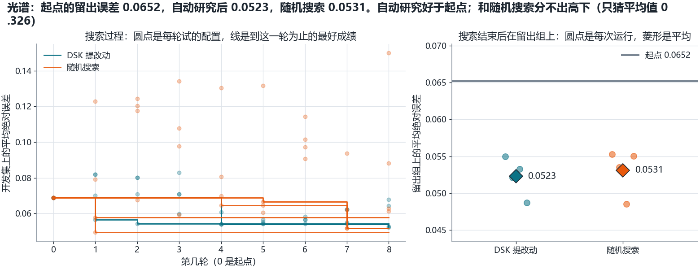

DSK 最好的那次运行选中第 8 轮，留出误差 0.04874，相对起点改了 `{"objective": "masked", "mask_ratio": 0.3, "readout": "finetune", "pretrain_steps": 3200}`。它提这个配置时的理由：finetune 已稳定优于 probe（约0.054），pool=last 未改善（0.0622）。下一步在最佳 finetune 配置（200步/0.001）基础上，尝试更长的预训练 3200→6400 已用过，故改用 masked 目标配合 finetune，检验不同自监督目标在微调下是否互补；保持 merge=……

### 蛋白质：好于起点；和随机搜索分不出高下

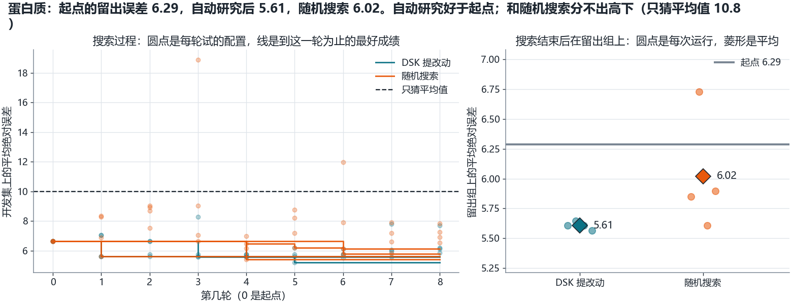

DSK 最好的那次运行选中第 5 轮，留出误差 5.564，相对起点改了 `{"objective": "masked", "readout": "finetune"}`。它提这个配置时的理由：masked 0.3 目前最佳（5.58），0.5 变差，说明遮挡比例不宜过大；finetune 200 步/lr=0.001 与 400 步/lr=0.0003 差异在种子波动内。下一步在最佳 masked 0.3 基础上测试更小遮挡 0.15，保持 finetune 200 步/lr=0.001，以单独考察更温和的……

### DNA：没有稳定好于起点；和随机搜索分不出高下

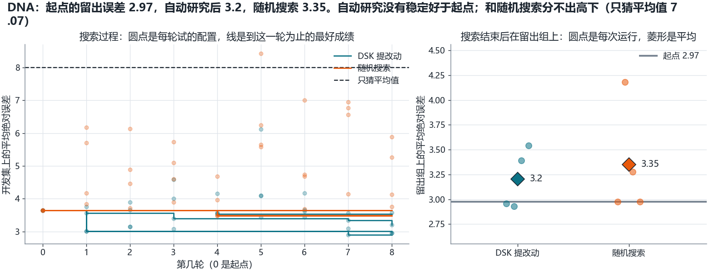

DSK 最好的那次运行选中第 8 轮，留出误差 2.928，相对起点改了 `{"objective": "masked", "mask_ratio": 0.3, "finetune_steps": 400, "finetune_lr": 0.0003}`。它提这个配置时的理由：finetune_steps 从 200 提到 400 带来小幅改善（3.09 vs 3.01），但仍在种子波动内；下一步固定最优预训练组合，把 finetune_lr 降到 0.0003 配合 400 步，测试更小步长能否稳定微调并降低种子方差。

### RNA：好于起点；和随机搜索分不出高下

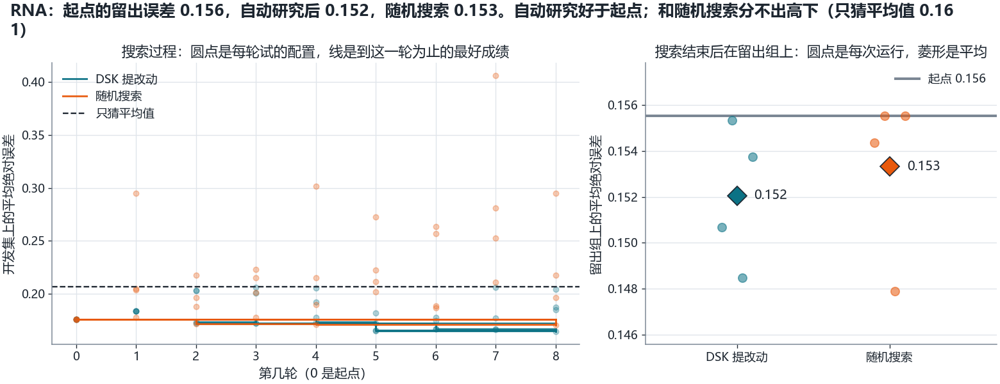

DSK 最好的那次运行选中第 6 轮，留出误差 0.1485，相对起点改了 `{"pretrain_lr": 0.0003, "ridge_alpha": 10.0}`。它提这个配置时的理由：probe+mean 下低预训练学习率0.0003配合1600步是目前最优(0.1723)；ridge_alpha=0.1反而变差(0.1820)，说明需要更强正则化。下一步测试 ridge_alpha=10.0，在32个下游标签的小样本下更强收缩可能降低方差、改善MAE，其余保持最优主干配置以隔离正则强度的影响。

### 小分子：好于起点；好于随机搜索

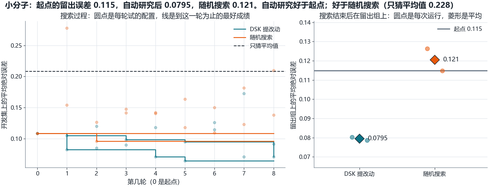

DSK 最好的那次运行选中第 5 轮，留出误差 0.07871，相对起点改了 `{"objective": "masked", "mask_ratio": 0.5, "readout": "finetune"}`。它提这个配置时的理由：masked 目标把 dev_mae 从 0.08235 降到 0.07078，说明掩码预训练更匹配下游。下一步保持 finetune 最优设置，只把 mask_ratio 从 0.3 提到 0.5，让表示学到更多上下文，预期进一步降低误差，同时检查更大掩码比例是否稳定。

### 晶体：没有稳定好于起点；和随机搜索分不出高下

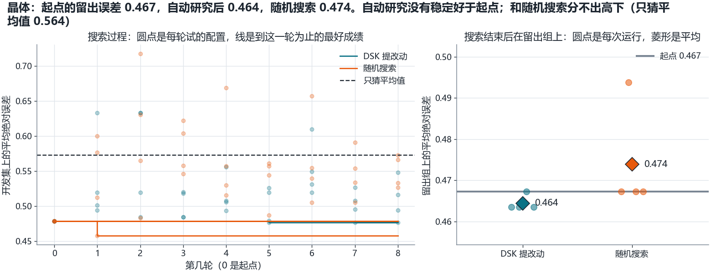

DSK 最好的那次运行选中第 7 轮，留出误差 0.4635，相对起点改了 `{"finetune_steps": 400}`。它提这个配置时的理由：起点 next+finetune（0.479）仍是唯一明显最优，probe 更差，pool=last、更长/更短 finetune、降预训练 lr 均未超过起点；说明应保留 next+finetune+mean 与起点预训练设置，仅把 finetune_steps 增到 400 同时保持 finetune_lr=0.0……

### 三维结构：好于起点；好于随机搜索

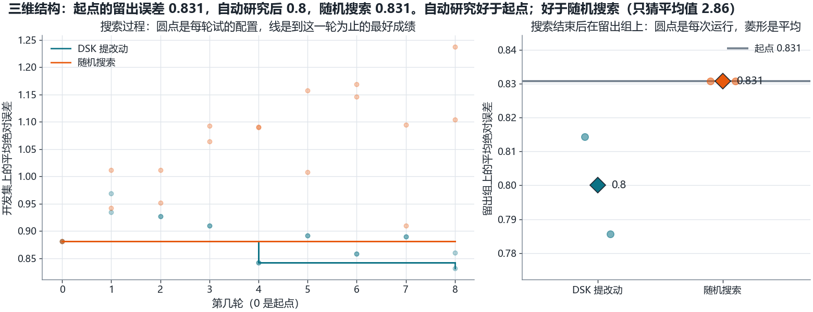

DSK 最好的那次运行选中第 8 轮，留出误差 0.7857，相对起点改了 `{"objective": "masked", "mask_ratio": 0.3, "pretrain_lr": 0.003}`。它提这个配置时的理由：masked/0.3 在 merge=1 时最好（0.842），merge=2 略差（0.890），说明块级合并损失了细节；当前主要瓶颈可能是预训练步数/学习率，而非结构。下一步在最佳 masked/0.3 + probe 配置上试更高预训练学习率 0.003，看能否学到更好的补全表示，其余保持第 4 轮以隔离变量。

### 天气场：好于起点；好于随机搜索

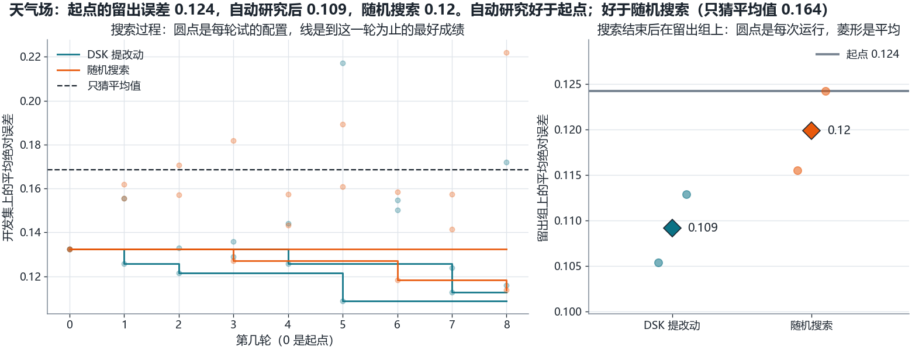

DSK 最好的那次运行选中第 5 轮，留出误差 0.1054，相对起点改了 `{"objective": "masked", "pretrain_lr": 0.003, "ridge_alpha": 10.0}`。它提这个配置时的理由：probe 明显优于 finetune（0.1214 vs 0.1440），且 masked+mask_ratio 0.15 是最佳预训练设置。下一步保持该预训练配置，在 probe 下调整岭回归正则强度：尝试 ridge_alpha=10 以抑制 32 维特征上的过拟合，预期比 alpha=1.0 更稳定。

### 扩散场：没有稳定好于起点；没有跑赢随机搜索

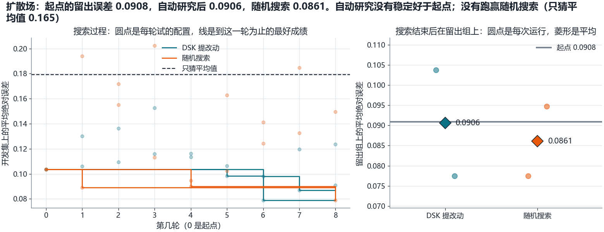

DSK 最好的那次运行选中第 6 轮，留出误差 0.07743，相对起点改了 `{"merge": 2, "finetune_steps": 400, "finetune_lr": 0.0003}`。它提这个配置时的理由：finetune 在 masked 与 next 下种子波动都很大（0.087–0.160），而 probe 稳定但偏弱；起点 next+finetune 均值最好。下一步用 merge=2 缩短序列、增强局部聚合，配合 next 目标与 finetune、较小 finetune_lr 和 400 步，检验是否能降低波……

### 天文图像：好于起点；好于随机搜索

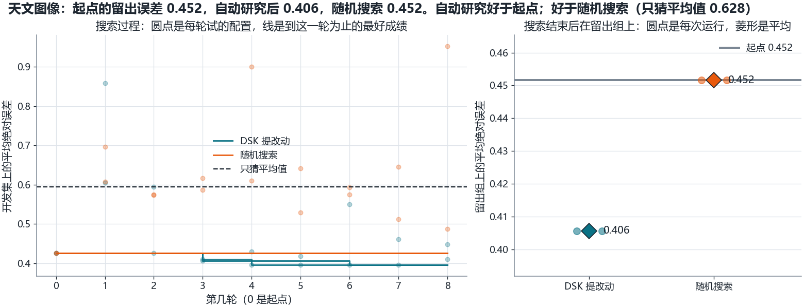

DSK 最好的那次运行选中第 6 轮，留出误差 0.4056，相对起点改了 `{"objective": "masked", "mask_ratio": 0.3, "readout": "finetune", "finetune_lr": 0.0003}`。它提这个配置时的理由：第3轮显示 ridge_alpha=10.0 在起点配置上最优且最稳（0.40591），而 masked 目标（第5轮 0.41753）与缩短预训练（第4轮 0.43007）均未超过它。下一步隔离测试读出方式：保持 masked+alpha=10.0 不变，改用 finetune 让全部权重适配下游任务，预期在 32 ……

### 文本：没有稳定好于起点；没有跑赢随机搜索

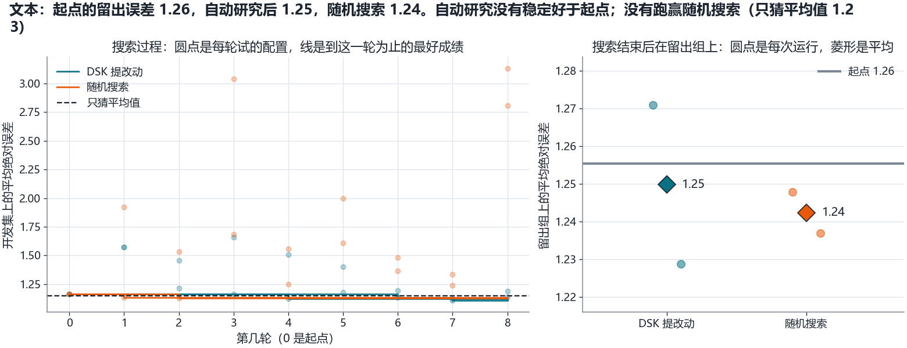

DSK 最好的那次运行选中第 7 轮，留出误差 1.229，相对起点改了 `{"merge": 2, "pretrain_lr": 0.003}`。它提这个配置时的理由：merge=2+next 是目前最好的配置(1.13335)，短序列方向有效；下一步在保持 merge=2+next+finetune+mean 的基础上增加预训练步数到 1600→仍为1600已是上限，改提高 pretrain_lr 到 0.003 以增强短序列上的预训练信号，预期表示更充分、dev_mae 进一步下……

## 读结果时要注意

- **每个方向只有 2 到 4 次重复。** “好于”只表示差距超过了各次运行之间的差别，算不上统计显著。
- **有几个“好于起点”的幅度很小。** RNA（2.2%）的留出误差只比起点低不到 3%，按写定的标准算好于起点，实际上和起点差不多。
- **DSK 的各次运行不完全独立。** 蛋白质、晶体、天文图像有两次以上的运行最后选中了同一个配置，这几次的留出误差完全相同，各次之间的差别低估了真实的波动。
- **开发集很小**（128 或 224 个对象）、每个配置 3 个种子。开发集上最好的配置，在留出组上可能不如起点。
- **搜索空间是十一个方向共用的**，没有针对某个方向的切法。扩散场上单独设计的搜索空间（可以改一个 token 含几个位置和几帧）找到过更大的改进，见[扩散场的自动研究](autoresearch-field.md)。
- **起点本身已经调过。** V1 默认配置的读出方式和预训练预算，是此前按开发集为每个方向选定的。

## 用量

DSK 共调用 265 次，其中 6 次因为格式不合格或提了做过的配置被退回重提，合计约 49 万 token。全部试验的训练时间合计约 13.0 小时（每次 2 个线程，机器上同时有别的任务）。[全部试验的配置、成绩和理由](autoresearch-eleven/trials.csv) · [逐方向汇总](autoresearch-eleven/summary.csv) · [存档的运行记录](autoresearch-eleven/results.json)

## 怎么做的

- **不能改**：2 层、2 头、32 维的 nanoGPT 主干。提议里出现别的键会被拒绝。
- **可以改**（十一个方向相同）：相邻两个 token 是否并成一个、预训练目标（预测下一个、隔一个预测、遮住一部分输入再预测）和遮盖比例、预训练步数和学习率、读出方式（冻结主干加岭回归，或全参数微调）及其岭回归强度、微调步数、微调学习率、表示的汇总方式（对全部 token 取平均，或取最后一个 token）。
- **起点**：V1 默认配置。十一个方向都核对过：种子 53、2 个线程时，搜索程序算出的起点留出误差与默认入口（12,800 个无标签对象）逐位相同。[核对记录](autoresearch-eleven/start-check.json)
- **一次运行**：8 轮，每轮一个配置。每个配置在开发集上用 3 个种子打分。开发集是标签池里没被该种子抽作训练标签的对象。
- **留出组 A**：每次运行只在 8 轮结束后评一次，对象是开发集误差最低的配置，用 5 个种子。
- **两种提法**：DSK 读此前每一轮的配置、各种子的开发集误差和理由，提下一个配置；随机搜索在同一范围里均匀抽样。两边各跑 2 次，其中五个方向后来补到 4 次。

## 胜负标准

写在运行之前：

- **好于起点**：DSK 每次运行在留出组上的误差都低于起点。
- **好于随机搜索**：DSK 各次的平均低于随机搜索各次的平均，并且差距大于两种方法各自运行里最大值与最小值之差中较大的那个。差距不到这个量，记为“分不出高下”；DSK 平均更高，记为“没有跑赢”。
- 选中的配置就是起点时，记为“没有找到更好的配置”。

每个方向只有 2 到 4 次重复，这条标准只能排除明显的偶然，算不上统计检验。

在搜索里把别的方向的经验带进来的实验，见[把搜索经验带到没见过的方向](search-skill.md)。

## 自己运行

在仓库根目录：

```bash
python -m autoresearch.common_search --field field --method random
python -m autoresearch.common_search --field field --method model
```

`--field` 可以换成十一个方向里的任意一个。`--method model` 需要先在自己的进程环境里设置 `SCNET_API_BASE`、`SCNET_API_KEY`、`SCNET_MODEL`，密钥不写进任何文件。运行记录存在 `out/search/<方向>/<方法>-<次数>/journal.json`，同一个配置在同一个种子上的结果存在 `out/search/cache/` 里复用，中断后用同一条命令接着跑。

这两条命令用的是存档的设置：8 轮，每个配置 3 个种子，结束后 5 个种子评留出。存档的那批运行里，一次运行的训练时间从三维结构的约 5 分钟到扩散场的约 23 分钟不等（同时跑着六到九路，单独跑会快一些）。 只想几分钟内看一遍流程，加上 `--rounds 2 --seeds 53`，这也是 Notebook 第 7 节的默认设置；这么少的轮数和种子，结果的波动比存档大得多。

结果与线程数有关：晶体用 1 个线程和 2 个线程训练出的模型不同。上面的数字都用 2 个线程，命令的默认值也是 2。
