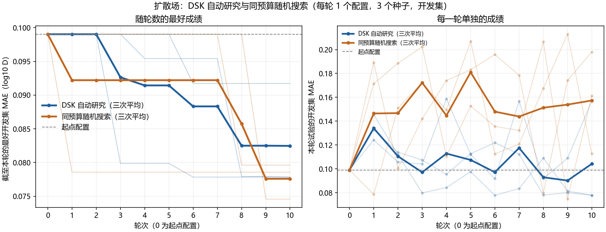

# 扩散场上的自动研究：DSK 提改动 vs 同预算随机搜索

**结论：在这个设置下，DSK 自动研究没有赢过随机搜索。** 两边各跑 3 次、每次 10 轮。10 轮后的最好开发集误差，DSK 三次平均 0.0825，随机搜索 0.0776；起点配置是 0.0990。DSK 每一轮提的配置平均更好：30 次试验的开发集误差平均 0.106，有 43% 好过起点；随机搜索平均 0.155，只有 10% 好过起点。但随机搜索方差大，偶尔能抽到很好的配置，只看最好成绩时略胜。两边找到的最有用改动是同一个：每个 token 从 4 个空间位置 × 4 帧，改成 8 个位置 × 4 帧。



| | 第 1 次 | 第 2 次 | 第 3 次 |
|---|---|---|---|
| DSK：10 轮后最好开发集误差 | 0.0778（第 6 轮） | 0.0778（第 10 轮） | 0.0917（第 6 轮） |
| DSK：确认集 A / B | 0.0747 / 0.0774 | 0.0747 / 0.0774 | 0.0986 / 0.1036 |
| 随机：10 轮后最好开发集误差 | 0.0796（第 8 轮） | 0.0746（第 9 轮） | 0.0786（第 1 轮） |
| 随机：确认集 A / B | 0.0759 / 0.0791 | 0.0811 / 0.0848 | 0.0719 / 0.0756 |

起点配置在确认集上是 0.0905 / 0.0936。误差单位是扩散系数 log10 的平均绝对误差。确认集在每次运行的 10 轮全部结束后、只对开发集最好的那个配置评一次，用 5 个种子，中间各轮只看开发集（3 个种子）。

## 设置

- **固定不变**：主干是 2 层、2 头、32 维的 nanoGPT，写死在 `autoresearch/eleven_search.py` 里，提议里出现别的键会被拒绝。每次试验都用同样的 12,800 个无标签场、每个种子 32 个标签、480 个开发样本。
- **允许改的**：一个 token 包含几个空间位置（4、8、16）和几帧（1、2、4）、按空间还是按时间排列；预训练目标（预测下一个 token、隔一个预测、先遮盖一部分输入再预测）和遮盖比例；预训练步数（800 到 6,400）和学习率；读出方式（冻结主干加岭回归，或全参数微调）及其步数、学习率。
- **DSK**：每轮读此前全部轮次的配置、开发集误差、预训练损失和理由，返回一个新配置和一两句理由。3 次运行共调用 30 次，全部一次通过格式检查，合计约 58 千 token。温度 0.7。密钥只从进程环境变量读取，不写进任何文件。
- **随机搜索**：在同一个空间里均匀抽样，跳过做过的配置。
- **算力**：每次运行在 CPU 上用 2 个线程，10 轮约 26 到 32 分钟；6 次运行并行。

## DSK 第 1 次运行每一轮做了什么

| 轮 | 开发集误差 | 配置 | DSK 给的理由（节选） |
|---:|---:|---|---|
| 0 | 0.0990 | 4 个位置 × 4 帧；预测下一个；预训练 6400 步、学习率 0.001；全参数微调 200 步、学习率 0.001 | 起点：README 中扩散场的配置 |
| 1 | 0.1455 | 4 个位置 × 4 帧；预测下一个；预训练 6400 步、学习率 0.001；冻结读出（岭回归 α=10.0） | 起点使用 4×4 token 和微调读出，dev_mae 约 0.099；在 32 个标签样本下，微调容易过拟合，而 probe 加岭回归通常更稳。先保留同一 tokenizati… |
| 2 | 0.1120 | 4 个位置 × 4 帧；预测下一个；预训练 3200 步、学习率 0.001；全参数微调 200 步、学习率 0.001 | probe 明显劣于 finetune（0.145 vs 0.099），说明冻结特征线性可读性不足，需要保留微调读出。下一步在微调读出的基础上缩短预训练步数到 3200，减少过拟合… |
| 3 | 0.0799 | 8 个位置 × 4 帧；预测下一个；预训练 6400 步、学习率 0.001；全参数微调 200 步、学习率 0.001 | probe 显著劣于 finetune，说明需要保留微调读出；缩短预训练到 3200 反而更差（0.112 vs 0.099），表明 6400 步预训练更充分。下一步尝试增大 to… |
| 4 | 0.0843 | 16 个位置 × 4 帧；预测下一个；预训练 6400 步、学习率 0.001；全参数微调 200 步、学习率 0.001 | 增大 space_per_token 到 8 明显提升（0.0799 vs 0.099），说明更大 token 覆盖范围有利于特征质量。下一步在保留 4 帧/ token 与微调读… |
| 5 | 0.0976 | 8 个位置 × 2 帧；预测下一个；预训练 6400 步、学习率 0.001；全参数微调 200 步、学习率 0.001 | space_per_token=8 在 4 帧/token 下最佳（0.0799），而 16 略差（0.0843），说明单 token 覆盖过大反而损失细节。下一步保持空间 8 不… |
| 6 | 0.0778 | 8 个位置 × 4 帧；遮盖 30% 后预测下一个；预训练 6400 步、学习率 0.001；全参数微调 200 步、学习率 0.001 | space_per_token=8、frames_per_token=4 是当前最佳（0.0799），而 frames_per_token=2 变差（0.0976），说明 4 帧/… |
| 7 | 0.0834 | 8 个位置 × 4 帧；遮盖 50% 后预测下一个；预训练 6400 步、学习率 0.001；全参数微调 200 步、学习率 0.001 | masked 目标在最佳 tokenization 下带来小幅提升（0.0778 vs 0.0799），说明掩码重建有助于表征质量。下一步保持 space=8、frames=4 与… |
| 8 | 0.1090 | 8 个位置 × 4 帧；遮盖 30% 后预测下一个；预训练 6400 步、学习率 0.0003；全参数微调 200 步、学习率 0.001 | masked 目标在 mask_ratio=0.3 时最佳（0.0778），0.5 反而变差，说明 0.3 附近掩码强度更合适。当前最优配置仍使用 space=8、frames=4… |
| 9 | 0.0814 | 8 个位置 × 4 帧；遮盖 30% 后预测下一个；预训练 6400 步、学习率 0.001；全参数微调 400 步、学习率 0.001 | 当前最佳是 masked/0.3、space=8、frames=4、微调读出（0.0778）；预训练学习率降到 0.0003 明显变差（0.109），说明 0.001 合适。下一步… |
| 10 | 0.0778 | 8 个位置 × 4 帧；遮盖 30% 后预测下一个；预训练 6400 步、学习率 0.001；全参数微调 200 步、学习率 0.001 | 当前最佳是 masked/0.3、space=8、frames=4、微调 200 步（0.0778）；400 步微调反而变差（0.0814），说明 200 步已接近最优。下一步保持… |

DSK 的思路清楚：先试冻结读出，发现变差后固定用全参数微调；试出 8 个位置的 token 好于 4 个和 16 个；再加上遮盖预训练，小幅改善。

## 需要注意的地方

- **搜索空间里有不起作用的选项。** 每个 token 含 4 帧时，按空间还是按时间排列切出来的 token 完全相同；遮盖比例只在遮盖目标下起作用；岭回归强度只在冻结读出时起作用。DSK 第 1、3 次运行各有一轮只改了这类选项，结果和之前一模一样。第 2 次运行最后也收敛到和第 1 次等价的配置，所以两次的确认集成绩完全相同。
- **开发集选出的配置在确认集上不一定更好。** DSK 第 3 次运行选出的配置，在开发集上好过起点（0.0917 对 0.0990），在确认集上却比起点差（0.0986 / 0.1036 对 0.0905 / 0.0936）。只用 3 个种子的开发集误差，本身就有不小的波动。
- **只有 3 次重复**，谈不上统计显著。随机搜索第 3 次在第 1 轮就抽到了很好的配置，运气成分很大。

## 自己运行

在仓库根目录：

```bash
python -m autoresearch.eleven_search --method random --repeat 1 --out out/autoresearch
python -m autoresearch.eleven_search --method model --repeat 1 --out out/autoresearch
```

`--method model` 需要先在自己的进程环境里设置 `SCNET_API_BASE`、`SCNET_API_KEY`、`SCNET_MODEL`。每次运行在输出目录里留下 `journal.json`（每轮配置、成绩、理由和调用用量）以及每次提问和回答的原文。中断后用同一命令可以接着跑。[全部 66 次试验](autoresearch-field-trials.csv)
