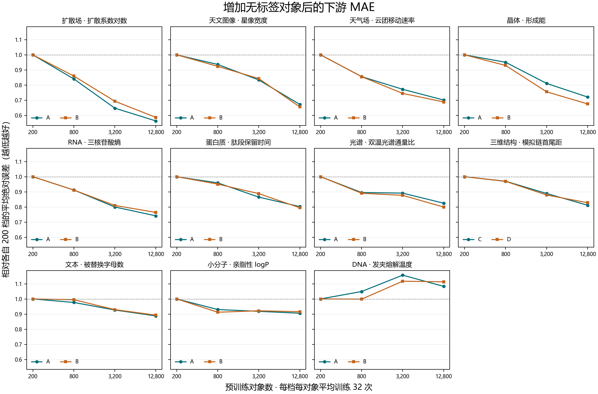

# 科学输入怎样进入同一个 nanoGPT？

把观测切成 token 后，模型用前面的 token 预测下一个 token。每个对象经过同一个两层、两头、32 维的因果 Transformer。微调时，对有效 token 的最后一层表示取平均，用同一个线性层输出一个标量，32 个标签参与全模型更新。三个编码器分别处理离散符号、连续数值块、带晶格和元素位置的晶胞。[模型](../../nanoscigpt/scientific/scigpt.py) · [编码器和预训练损失](../../nanoscigpt/scientific/encoders.py)

| 方向 | 本版的一个 token | 一条样本的编码示意 | 下游预测 |
|---|---|---|---|
| 光谱 | 连续 4 个波长的通量 | 64 个采样点 → 16 个四维块 | 模拟双温光谱的紫外/可见通量比（对数） |
| 蛋白质 | 1 个氨基酸字符 | 酵母肽段 → 最多 32 个位置，词表 19 项含填充 | 实测色谱保留时间 |
| DNA | 1 个碱基 | 发夹 → 最多 18 个位置，词表 6 项含未知和填充 | 实测熔解温度 |
| RNA | 1 个碱基 | 核糖体 RNA → 32 个位置，词表 6 项 | 三核苷酸熵 |
| 小分子 | 1 个 SMILES 词法单元 | `Cl`、`[C@@H]` 各占一个位置，最多 92 个位置，词表 49 项 | 实测亲脂性 logP |
| 晶体 | 晶格矩阵占首个 token，每个原子的元素和分数坐标占一个 token | ABX₃ 晶胞 → 晶格 + 5 个原子；元素嵌入有 119 个槽位 | 密度泛函计算形成能 |
| 三维结构 | 原子间距离矩阵中的一个 4×4 块 | 模拟链 16 个点 → 16 块 → 遮去两个对称块，余 14 个 token | 模拟链首尾距（单位键长） |
| 天气场 | 同一 4×4 区域的连续四帧 | 四幅 16×16 场 → 16 个 64 维块 | 模拟云团移动速率 |
| 扩散场 | 同一组 4 个相邻位置的连续四帧 | 四帧一维场，每帧 64 个位置 → 16 个 16 维块 | 模拟扩散系数的对数 |
| 天文图像 | 4×4 像素块 | 16×16 图像 → 16 个 16 维块 | 模拟星像半高全宽 |
| 文本 | 1 个字母或空格 | 小写英文行 → 最多 62 个位置，词表 28 项含填充 | 人为替换的字母数 |

连续数值块直接做线性投影，没有离散词表。符号序列的预训练损失是下一个符号的交叉熵，连续块用下一个块的均方误差，晶体用下一个元素的交叉熵。

## 固定训练步数时，增大语料有什么用？

DNA、RNA、小分子已有一组只看预训练的对照。每档都做 1,600 次更新，在各自独立于训练的开发样本上计算下一 token 交叉熵。表中每项都是五种子均值，越低越好。DNA 在 3,200 档后几乎持平，RNA 和小分子的均值四档逐级下降。三个方向的最大档均有 5/5 个种子优于最小档。[开发集原始值](next-token.csv)

| 科学输入 | 200 个对象 | 800 | 3,200 | 12,800 | 端点降幅 |
|---|---:|---:|---:|---:|---:|
| DNA | 2.25275 | 1.38584 | 1.34927 | 1.34935 | 40.1% |
| RNA | 2.70730 | 1.42451 | 1.37977 | 1.37636 | 49.2% |
| 小分子 | 2.71231 | 1.31931 | 1.15347 | 1.13489 | 58.2% |

在此后抽取的 A、B 留出组中，从 200 到 12,800，DNA 的交叉熵分别降低 40.1%、40.3%，RNA 降低 49.3%、49.0%，小分子降低 59.1%、56.5%。RNA 和小分子的两组均值四档逐降，DNA 最后一段基本持平。每组每个方向均有 5/5 个种子在最大档优于最小档。[留出曲线、逐种子成绩和 RNA 复现命令](symbol-scaling/README.md)

## 在 CPU 上复现三维结构

在仓库根目录启动。预训练只读剔除目标块后的距离，监督阶段才读取首尾距。所有模拟数据由程序在本地生成。

```bash
python -m pip install -e .
python -m nanoscigpt.tasks.structure_scale
```

默认固定种子 53，跑 200、800、3,200 三档。每档输出 C、D 各 480 条链上的 MAE，单位为键长。种子 53 的两组都会在 800 档小幅回升。完整复现用下行命令，含零预训练对照、四个非零规模和五个种子。[逐种子参考值](structure-per-seed.csv) · [Notebook](structure-scale.ipynb)

```bash
python -m nanoscigpt.tasks.structure_scale --full > structure-scale.csv
```

本次在全新 Windows Python 3.12.10 环境中，用 CPU 版 PyTorch 2.12.0 和两个计算线程复现。安装依赖后，Notebook 三个代码单元共用 27.3 秒。五种子完整命令用时 4 分 39 秒，50 个确认集 MAE 与原回执的最大绝对差为 4.7 × 10⁻⁸ 以内。

## 十一方向的规模曲线

每条曲线以本组 200 档的五种子平均 MAE 为 1，数值越低越好。三维结构的两组为 C、D，其余方向为各自的 A、B。9 个方向的两条曲线都逐档下降。独立确认采用五个固定种子，每一个种子在各档使用同一组 32 个监督标签。四档每个无标签对象平均采样 32 次，训练更新分别为 100、400、1,600、6,400 步。因此结果同时包含新增数据与更多训练的收益。[各档原始单位 MAE 和端点种子计数](scale.csv)



三维结构的 C、D 两组端点 MAE 分别降低 18.9%、17.2%，两组都在五种子均值上连续下降三档。小分子另试了 QM9 转动常数 B，按非氢元素组成分开的两组分子各有 480 个。A 组 MAE 为 0.362、0.326、0.346、0.328 GHz，B 组为 0.366、0.328、0.315、0.307 GHz。两组均有 5/5 个种子的端点改善。A 组中间档回升，这项仍列作部分改善。DNA 与 RNA 新试的链方向标签都止于冻结表示的开发筛选，均只有 1/5 个种子改善。上述记录属于上轮对照。 [三个候选的冻结读出](frozen-probes.csv) · [转动常数 B 的逐种子成绩](rotational-B-per-seed.csv)
