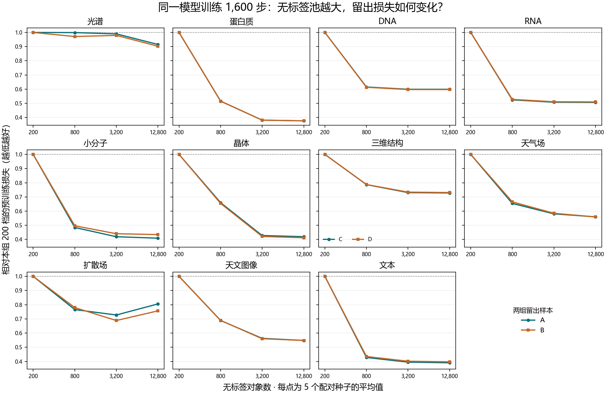

# 固定更新次数，只扩大预训练数据池

**11/11** 个方向在两组留出样本上，12,800 个对象的平均预训练损失都低于 200 个对象。**8/11** 个方向两组的四档均值都逐档下降。每项有五个配对种子，表中端点和相邻段数按未四舍五入的数值计算。



| 方向 | 预训练预测什么 | 200 → 12,800 降幅（两组） | 均值下降段 | 端点改善种子 |
|---|---|---:|---:|---:|
| 光谱 | 双温模拟谱的下一个通量块 | 8.5% / 9.7% | 3/3、2/3 | 5/5、5/5 |
| 蛋白质 | 酵母肽段的下一个氨基酸 | 62.4% / 62.3% | 3/3、3/3 | 5/5、5/5 |
| DNA | 酿酒酵母基因组的下一个碱基 | 40.1% / 40.3% | 2/3、2/3 | 5/5、5/5 |
| RNA | Rfam 核糖体 RNA 的下一个碱基 | 49.3% / 49.0% | 3/3、3/3 | 5/5、5/5 |
| 小分子 | QM9 分子的下一个 SMILES 单元 | 59.1% / 56.5% | 3/3、3/3 | 5/5、5/5 |
| 晶体 | 钙钛矿晶胞的下一个元素 | 58.0% / 58.7% | 3/3、3/3 | 5/5、5/5 |
| 三维结构 | 模拟链遮块后下一个距离块 | 27.2% / 26.9% | 3/3、3/3 | 5/5、5/5 |
| 天气场 | 模拟天气场的下一个四帧空间块 | 44.0% / 44.1% | 3/3、3/3 | 5/5、5/5 |
| 扩散场 | 模拟扩散场的下一个四帧空间块 | 19.4% / 24.3% | 2/3、2/3 | 4/5、5/5 |
| 天文图像 | 模拟星场的下一个像素块 | 45.2% / 45.2% | 3/3、3/3 | 5/5、5/5 |
| 文本 | 英文原文的下一个字符 | 60.9% / 60.3% | 3/3、3/3 | 5/5、5/5 |

光谱 A 组三段均下降，B 组从 800 到 3,200 的 MSE 小幅回升。DNA 的两组在 3,200 以后几乎持平。扩散场的两组都在 3,200 档损失最低，12,800 档仍优于 200 档。三维结构两组记为 C、D，其余为 A、B。

## 比较条件

200、800、3,200 三档的池中对象都实际抽到过。标为 12,800 的一档，五个种子分别实际抽到 12,793 至 12,797 个不同对象。这四档测试的是用相同的更新预算覆盖更多不同对象的效果。

每个输入编码为符号、数值块或晶胞单元，送入统一的两层、两头、32 维 nanoGPT。固定每批 64 个对象和 1,600 次更新，每档抽样 102,400 次。小池会反复抽到同一对象，四个池按同种子排列取嵌套前缀。固定长度输入的有效预测位置数相同，变长符号输入按非填充目标计数，各档实际预测的 token 数见逐种子表。连续块的损失按被预测分量汇总，符号和晶体按有效目标汇总。不同方向的绝对损失使用各自的单位。

五种子的训练在 CPU 上进行。预训练没有读取下游标签。连续块标准化及晶格缩放只用独立校准池中固定的 32 个输入，同一方向同一种子的四档共享校准结果。DNA、RNA、小分子沿用上一轮封存的 60 个模型，另外八项补训 160 个。每项使用两个历史留出面板，蛋白质每组 400 个对象，其余每组 480 个。文本测未扰动原文；三维距离矩阵遮去含首尾距的两个对称块。模拟数据来自各自生成器，结果的适用范围是这些数据分布。

复算直接累加未微调模型的逐目标损失。220 份已校验权重共得到 440 个留出分数，全部与回执一致。109/110 个方向、组别和种子的配对在最大档优于最小档。相同种子及其评估对象在四档复用，这个计数是描述性结果。

这张表里的晶体任务预测给定原子顺序中的下一个元素，三维结构任务预测所见距离块的后继。形成能、首尾距、熔解温度等监督目标另有独立的下游表。

[各档原始单位损失](summary.csv) · [逐种子回执与复算](per-seed.csv) · [固定平均遍数的下游结果](../README.md) · [DNA 和小分子的新标签开发实验](../symbol-scaling/transfer-check.md)

## 本地 CPU 复现

解压本轮的《十一方向预训练复现包》，从解压目录运行。包内含输入面板、核心训练代码和参考损失。默认种子 53，四档各训练 1,600 步。加 `--full` 跑五个种子。已有兼容的 CPU 环境时可以直接执行训练命令。

```bash
python -m pip install torch --index-url https://download.pytorch.org/whl/cpu
python -m pip install numpy scikit-learn
python run.py --domain spectrum
python run.py --domain rna --full
```

方向参数可选 `spectrum protein dna rna smiles crystal structure3d weather field image text`。在仓库内运行时，给本页的 `run.py` 加 `--data-dir` 指向复现包的 `data` 目录。

## 解压复现

在 Windows 和 WSL Ubuntu 24.04 分别把相同 ZIP 解压到空目录。每个方向用包内训练代码从相同的种子 53 开始重新训练四档。每个平台共产生 88 个留出分数。四个任务并发，每个任务两个 PyTorch 线程；计时从启动训练到全部退出，环境安装和解压另计。

Windows 的十一项合计 4 分 19 秒，与五种子实验中该种子的参考记录最大绝对差为 1.3e-07。Linux 合计 3 分 45 秒，48/88 个数值在相对容差 3×10⁻⁶、绝对容差 10⁻⁹ 内。单种子的端点方向一致 22/22，相邻档方向一致 66/66。最大相对差为 2.338%。

[逐平台耗时和数值核对回执](platform-receipts.json)

相对差最大的是晶体 A 组的 200 档，Windows 的交叉熵为 4.22282，Linux 为 4.12408。五种子总表使用 Windows 参考值。跨平台复跑覆盖演示种子 53。
