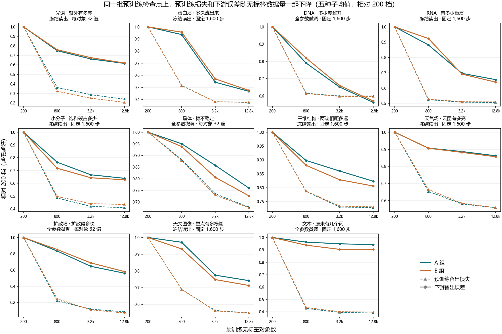

# 同一方向共用一套预训练权重，下游误差随预训练规模下降

每个方向只训练一套预训练检查点：五个种子，四档无标签数据量（200、800、3,200、12,800 个对象）。画预训练曲线用的是这批检查点，下游任务也从这批检查点出发，只用 32 个标签训练读出。11 个方向各有一个下游任务，在两组留出样本上五种子平均误差三段都下降。

| 方向 | 下游任务 | 读出 | 预训练预算 | 预训练损失降幅（A / B，下降段） | 下游误差降幅（A / B，下降段，端点改善种子） | 12,800 档比不预训练 | 12,800 档误差 ÷ 只猜均值 |
|---|---|---|---|---:|---:|---:|---:|
| 光谱 | 紫外/可见通量比 | 冻结读出 | 每对象 32 遍 | 76%（3/3） / 79%（3/3） | 38.4%（3/3，5/5） / 38.0%（3/3，5/5） | +42% / +40% | 0.20 / 0.21 |
| 蛋白质 | 色谱保留时间 | 冻结读出 | 固定 1,600 步 | 62%（3/3） / 62%（3/3） | 53.2%（3/3，5/5） / 52.5%（3/3，5/5） | +9% / +10% | 0.58 / 0.61 |
| DNA | 发夹熔解温度 | 全参数微调 | 固定 1,600 步 | 40%（2/3） / 40%（2/3） | 43.7%（3/3，5/5） / 42.9%（3/3，5/5） | +21% / +22% | 0.42 / 0.44 |
| RNA | 三核苷酸熵 | 冻结读出 | 固定 1,600 步 | 49%（3/3） / 49%（3/3） | 34.5%（3/3，5/5） / 36.1%（3/3，5/5） | +22% / +28% | 0.97 / 0.86 |
| 小分子 | sp³ 杂化碳比例 | 冻结读出 | 固定 1,600 步 | 59%（3/3） / 57%（3/3） | 36.1%（3/3，5/5） / 37.3%（3/3，5/5） | -7% / +5% | 0.50 / 0.60 |
| 晶体 | 赝立方晶格常数 | 全参数微调 | 固定 1,600 步 | 58%（3/3） / 59%（3/3） | 46.6%（3/3，5/5） / 48.2%（3/3，5/5） | +81% / +82% | 0.21 / 0.20 |
| 三维结构 | 首尾距 | 冻结读出 | 固定 1,600 步 | 27%（3/3） / 27%（3/3） | 17.7%（3/3，5/5） / 19.4%（3/3，5/5） | +23% / +20% | 0.29 / 0.31 |
| 天气场 | 平均云团亮度 | 冻结读出 | 固定 1,600 步 | 44%（3/3） / 44%（3/3） | 13.8%（3/3，4/5） / 14.3%（3/3，4/5） | +26% / +24% | 0.76 / 0.81 |
| 扩散场 | 扩散系数对数 | 全参数微调 | 每对象 32 遍 | 91%（3/3） / 93%（3/3） | 43.9%（3/3，5/5） / 41.9%（3/3，5/5） | +52% / +50% | 0.55 / 0.56 |
| 天文图像 | 星像半高全宽 | 冻结读出 | 固定 1,600 步 | 45%（3/3） / 45%（3/3） | 25.8%（3/3，5/5） / 28.7%（3/3，5/5） | +14% / +14% | 0.72 / 0.70 |
| 文本 | 去空格后的词数 | 全参数微调 | 固定 1,600 步 | 61%（3/3） / 60%（3/3） | 5.8%（3/3，4/5） / 9.6%（3/3，5/5） | +11% / +13% | 1.02 / 0.94 |

“冻结读出”指主干不动，对最后一层的均值池化表示做标准化，再用岭回归（alpha=1）读出一个数。“全参数微调”指更新全部权重 200 步，学习率 0.001。“固定 1,600 步”的四档更新次数相同，曲线只反映数据量；“每对象 32 遍”的更新次数是对象数的一半，数据和训练量一起增长。

## 口径统一

6 个方向用统一口径：冻结主干，只训练线性头，固定 1,600 步。分别是蛋白质、RNA、小分子、三维结构、天气场、天文图像。另外 5 个方向保留原做法，原因如下。

| 方向 | 统一口径下的留出结果（A / B） | 保留的做法 |
|---|---|---|
| 光谱 | 下游只降 4.4% 和 3.0%，均为 2/3 段；固定 1,600 步时预训练损失 B 组也只有 2/3 段 | 每对象 32 遍，冻结读出 |
| 扩散场 | 下游降 2.0%、升 1.6%，均为 2/3 段；固定 1,600 步时预训练损失在 3,200 档最低 | 每对象 32 遍，全参数微调 |
| 文本 | 词数降 10.8% 和 13.9%，均为 2/3 段，误差是只猜均值的 1.3 到 1.4 倍 | 全参数微调 |
| 晶体 | 见下节，换成了晶格常数 | 全参数微调 |
| DNA | 两组都三段下降（降 51% 和 52%），但 12,800 档比不预训练差 4% 到 5% | 全参数微调，12,800 档比不预训练好 21% 到 22% |

蛋白质和天文图像原来用全参数微调，改用冻结读出后两组都三段下降，于是改了口径。DNA 在冻结读出下也三段下降，但讲课需要看到预训练比不预训练更好，所以保留全参数微调。

## 文本、RNA、晶体的补筛

目标是找一个明显好于只猜均值的下游任务：12,800 档的误差不超过只猜均值的 0.7 倍，同时随规模三段下降。候选先在开发集上评估，选中后在两组留出样本上各评一次。

- **晶体：换成赝立方晶格常数**（晶胞体积的立方根）。两组降 47% 和 48%，误差约为均值基线的 0.2 倍，比不预训练好 81%。用的是全参数微调；冻结读出在开发集上只有 2/3 段。晶格矩阵本身就是输入的第一个 token，所以这个任务主要测模型能否把输入里的数读准，晶体化学方面的信息说明得不多。
- **RNA：没有合适的任务，保留三核苷酸熵。** 嘌呤占比在留出组上满足了三条判据（降 75% 和 74%，约为均值基线的 0.3 倍）。但不预训练时误差只有 0.0077，12,800 档是 0.0235，差了约 3 倍。GC 含量也是这样。成分统计用随机初始化嵌入的均值就能读出来，这类任务说明不了预训练的作用，所以不用。按 Rfam 共识结构算出的配对位置比例，达不到均值门槛。
- **文本：没有合适的任务，保留词数。** 平均词长、元音字母占比、行字符数在开发集上都没有同时满足三条，最接近的平均词长约为均值基线的 0.74 倍。

“12,800 档要比不预训练好”这一条，是在看到 RNA 嘌呤占比的留出结果后才加的，实验约定里另有说明。

晶体再做了一次遮住晶格矩阵的确认。两组的末档误差约 0.16 Å，均优于随机森林，但 200 → 800 档小幅回升。文本改用扰动率后，开发误差降到约 5.85 个百分点，最后两档持平。[独立复验的四档曲线和逐种子记录](masked-transfer.md)

## 其他需要注意的地方

- **DNA 的预训练损失最后一段持平。** 降幅 40%，但 3,200 到 12,800 档只差 10⁻⁵ 量级。改用每对象 32 遍后，预训练损失三段都下降，但重选出的下游任务在 A 组有一段回升，没有确认。
- **小分子 sp³ 比例**在 A 组的 12,800 档比不预训练差 7%。
- **晶体开发集曾经缩放了两次晶格。** 修正后按同一规则重选，留出组用的是原始晶格，不受影响。
- **读出方式和预算的调整都发生在看过第一轮留出结果之后。** 每次调整前，都先把规则写进实验约定。

[全部 84 组留出结果](all-holdout-results.csv) · [逐方向汇总](summary.csv) · [实验约定与各轮补充规则](protocol.md) · [固定步数预训练总表](../data-scaling/README.md)
