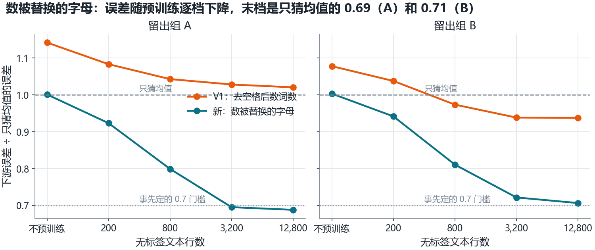

# 四处偏弱方向的打磨（2026-11-27）

V1 主表里有四处偏弱：晶体形成能在 200、800 档不如只猜均值；文本词数和只猜均值差不多；RNA 三核苷酸熵只比只猜均值好约一成，标签还能从输入直接数出来；DNA 的预训练损失在 3,200 → 12,800 档持平。这一轮主干、编码器和 32 个标签都不变，只换下游任务、读出头和预训练预算，分三批在开发集上筛，选中的组合在留出组 A、B 上各评一次。规则在每批运行前写进 [实验约定](protocol.md)，第二、三批是看过前一批开发结果后补的。

**结果：四个方向都没有按事先定的判据通过，V1 主表不变。** 文本最接近：换成“数一行里有几个字母被换掉”，读出模型自己的预测损失后，A 组四条判据全过，B 组只差均值门槛 0.007。

| 方向 | 试过的改法 | 开发集上最好的结果 | 卡在哪里 |
|---|---|---|---|
| 文本 | 三个词汇任务（用词常见度、罕见词占比、音节数）；被替换字母数和词数改用冻结读出；读出模型自己的预测损失 | 被替换字母数，冻结表示加预测损失读出，开发集四条全过 | 留出 B 组末档是只猜均值的 0.707 倍，门槛是 0.7 |
| 晶体 | 形成能，两套检查点 × 七种读出（冻结、交叉验证正则、三种微调强度、预测损失） | 每对象 32 遍检查点，微调 100 步，末档是只猜均值的 0.83 倍 | 每对象 32 遍时逐档下降，但 200、800 档高于只猜均值；固定 1,600 步时各档都低于只猜均值，但 200 → 800 档回升 |
| RNA | 四个由比对或注释决定的任务（保守程度、空位占比、大小亚基来源、在整条 rRNA 里的相对位置）；读出预测损失 | 都在只猜均值的 0.96 到 1.22 倍之间 | 32 个标签读不出这些量，预测损失和保守程度的相关始终在 ±0.16 以内 |
| DNA | 预训练改为固定 3,200 步和 6,400 步，各配冻结（交叉验证正则）和全参数微调 | 预训练损失三段都下降了（6,400 步：7.08 → 2.02 → 1.37 → 1.34） | 发夹熔解温度在 200 → 800 档回升；全参数微调时 12,800 档不如不预训练 |

## 文本：数被替换的字母

输入是保留空格的莎士比亚台词，其中若干字母被随机换成别的字母，标签是被换掉的字母个数。读出时先让冻结的预训练模型逐个预测下一个字母，取整行预测损失的平均值和最大值，和均值池化表示拼在一起，用岭回归读出，正则强度只用这 32 个标签做留一交叉验证选定。拼写越熟的模型，遇到被换掉的字母越“意外”，这正是预训练学到的东西。

| 留出组 | 不预训练 | 200 | 800 | 3,200 | 12,800 | 只猜均值 | 末档 ÷ 只猜均值 | 改善种子 |
|---|---:|---:|---:|---:|---:|---:|---:|---:|
| A | 2.296 | 2.118 | 1.833 | 1.595 | 1.579 | 2.293 | 0.688 | 5/5 |
| B | 2.273 | 2.133 | 1.837 | 1.635 | 1.601 | 2.265 | 0.707 | 5/5 |

两组都逐档下降，五个种子 12,800 档都好于 200 档，两组的五种子平均也都好于不预训练。B 组末档 0.707 倍，没到事先定的 0.7，所以按约定不替换主表。这个读出方式是看了开发集诊断之后才加的：种子 53 的检查点上，逐行预测损失与用词常见度的 Spearman 相关从不预训练的 −0.09 随规模升到 −0.63。

## 晶体

两套检查点各卡一处。每对象 32 遍的检查点在小档只训练 100 和 400 步，几乎等于没预训练，而 32 个标签下不预训练的模型无论哪种读出都不比只猜均值好（开发集误差 0.600 到 0.691，只猜均值 0.599），所以 200、800 档高于只猜均值。固定 1,600 步的检查点在 200 档就低于只猜均值（全参数微调 0.587），但 800 档反而回升到 0.591，曲线不是逐档下降。V1 的结论保持：到 3,200 档才超过只猜均值，末档低 17% 到 20%。

## RNA

这一批换掉了“直接数出来”的标签，改成要靠整个种子比对或 Rfam 注释才知道的量。结果 32 个标签对这些量几乎读不出任何东西，误差和只猜均值持平。两层、32 维的小模型在 32 nt 片段上预训练，学到的主要是局部组成，和片段在比对里的位置、保守程度关系不大。V1 的三核苷酸熵保持不变。

## DNA

加大预训练预算确实修好了预训练损失的持平：固定 3,200 步和 6,400 步时，五种子平均三段都下降。代价是 200 档只有 200 条序列却训练几千步，严重过拟合，预训练损失高达 4 到 7，下游的熔解温度在 200 → 800 档明显回升。V1 的固定 1,600 步和全参数微调保持不变。

## 文件

- [实验约定与两次补充](protocol.md)
- [开发集全部 51 个组合](development.csv)
- [选择结果](selection.json) · [留出确认](confirm_summary.json)

## 再换预训练语料：DNA 与 RNA

上面只换了下游任务、读出头和预训练预算。DNA 和 RNA 又试了一次换预训练语料，主干、编码器、四档规模、固定 1,600 步和 32 个标签的抽法都不变。规则在运行前写进 [这一轮的约定](corpus/protocol.md)。**两个方向都没有通过，V1 主表不变。**

- **DNA：预训练改用 Array Melt 文库里不属于 Watson–Crick 系列的 25,705 条发夹序列**（错配、凸起、各种环），和下游发夹出自同一个实验，预训练不读任何测量值。下游仍是 V1 的发夹熔解温度。预训练损失比基因组窗口低得多（约 0.69 对 1.35），说明模型学到了发夹茎的配对规律。但损失在 800 档之后就不再下降（开发留出 0.756 → 0.690 → 0.691）：这个文库是少数几种骨架上的变体，800 条已经覆盖了大部分花样。下游在开发集上 200 到 12,800 档都不如不预训练。
- **RNA：预训练改用 Rfam 全部家族的种子序列**，切成 64 nt 窗口，无标签池来自 1,722 个家族，下游四组各来自 92 到 104 个预训练里没出现过的家族。下游换成两个不能靠数碱基得到的量：ViennaRNA 算的折叠自由能（每个核苷酸），和共识二级结构里的配对位置比例。配对位置比例读不出来（只猜均值的 1.04 倍以上）。折叠自由能用冻结读出时，开发集上误差逐档下降、5/5 种子改善、好于不预训练，只差 0.7 倍门槛（0.84 倍）。

0.7 倍门槛是这次打磨才加的，V1 主表入表时没有。所以把 RNA 折叠自由能在留出组 A、B 上各评了一次，这一步是看过开发结果之后决定的，只作参考：

| 留出组 | 不预训练 | 200 | 800 | 3,200 | 12,800 | 只猜均值 | 末档 ÷ 只猜均值 | 改善种子 |
|---|---:|---:|---:|---:|---:|---:|---:|---:|
| A | 0.0686 | 0.0916 | 0.0797 | 0.0760 | 0.0668 | 0.0893 | 0.75 | 5/5 |
| B | 0.0647 | 0.0913 | 0.0808 | 0.0701 | 0.0670 | 0.0926 | 0.72 | 5/5 |

单位 kcal/mol/nt。两组都随预训练逐档下降，但不预训练时误差就已经很低，B 组 12,800 档还略差于不预训练。折叠自由能和 GC 含量关系很紧，随机初始化的嵌入取平均就能读出成分，所以这里看不出预训练的作用，连 V1 的入表标准也没过。

[选择结果](corpus/selection.json) · [留出检查](corpus/confirm_summary.json) · [数据规模与来源](corpus/data.json)

