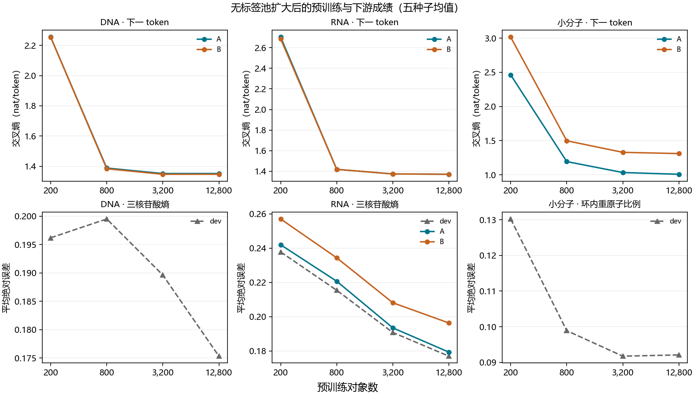

# 扩大无标签池的两项检验

三项各用四个嵌套的无标签对象池，五个固定种子。两组留出样本各 480 条。下面的降幅用两档的五种子平均误差计算，正数表示误差降低。端点胜数比较 12,800 和 200。

## 固定 1,600 次更新，预测下一个 token

每档抽取 102,400 个对象（可重复）。对每个确认组累计非填充目标 token 的负对数似然，再除以有效 token 总数。单位为 nat/token。

| 方向 | 组 | 200 | 800 | 3,200 | 12,800 | 端点降幅 | 800 到 12,800 降幅 | 端点胜数 | 均值下降段 |
|---|---|---:|---:|---:|---:|---:|---:|---:|---:|
| DNA | A | 2.25533 | 1.38809 | 1.35189 | 1.35190 | +40.1% | +2.6% | 5/5 | 2/3 |
| DNA | B | 2.25477 | 1.38346 | 1.34695 | 1.34703 | +40.3% | +2.6% | 5/5 | 2/3 |
| RNA | A | 2.70363 | 1.41828 | 1.37350 | 1.37055 | +49.3% | +3.4% | 5/5 | 3/3 |
| RNA | B | 2.68652 | 1.41852 | 1.37347 | 1.37043 | +49.0% | +3.4% | 5/5 | 3/3 |
| 小分子 | A | 2.46269 | 1.19360 | 1.03319 | 1.00787 | +59.1% | +15.6% | 5/5 | 3/3 |
| 小分子 | B | 3.01569 | 1.49810 | 1.32887 | 1.31084 | +56.5% | +12.5% | 5/5 | 3/3 |

200 → 800 是三项改善最大的一段。DNA 与 RNA 的单个片段固定长度，两者在各自的全部运行中分别预测了 6,451,200、3,174,400 个目标 token。SMILES 变长，实际目标数为 1,386,876 至 1,417,290。60 个固定预算模型重新计算原开发集交叉熵，逐项复现了上一轮记录。

最后一段 3,200 → 12,800，DNA 在 A、B 的平均交叉熵分别上升 0.000006、0.000083，逐种子是 4/5、1/5 改善。RNA 两组分别降低 0.00295、0.00304（4/5、5/5）；小分子分别降低 0.02532、0.01803（5/5、3/5）。每组的 5 个种子共享同一批留出对象。

## 用 32 个标签全参数微调

每个方向的两个候选先做冻结表示探针，再用通过探针门槛的候选做开发曲线。任何方向只有在开发均值连续下降三段后才可在 A/B 评估。下游采用原实验的固定平均遍数，四档更新步数为 100、400、1,600、6,400。

候选通过冻结筛选的情况如下。

- DNA · 三核苷酸熵，开发冻结读出 MAE 降幅 +25.1%，改善 5/5。
- DNA · 最长同碱基段，开发冻结读出 MAE 降幅 +8.5%，改善 5/5。
- RNA · 三核苷酸熵，开发冻结读出 MAE 降幅 +26.9%，改善 5/5。
- RNA · 共识配对状态切换次数，开发冻结读出 MAE 降幅 -6.5%，改善 2/5。
- 小分子 · 环内重原子比例，开发冻结读出 MAE 降幅 +13.3%，改善 5/5。
- 小分子 · 重原子图直径，开发冻结读出 MAE 降幅 +1.8%，改善 4/5。

| 方向 | 组 | 200 | 800 | 3,200 | 12,800 | 端点降幅 | 800 到 12,800 降幅 | 端点胜数 | 均值下降段 |
|---|---|---:|---:|---:|---:|---:|---:|---:|---:|
| DNA | dev | 0.19618 | 0.19949 | 0.18962 | 0.17534 | +10.6% | +12.1% | 4/5 | 2/3 |
| RNA | dev | 0.23778 | 0.21542 | 0.19082 | 0.17702 | +25.6% | +17.8% | 5/5 | 3/3 |
| RNA | A | 0.24196 | 0.22070 | 0.19353 | 0.17937 | +25.9% | +18.7% | 5/5 | 3/3 |
| RNA | B | 0.25699 | 0.23434 | 0.20815 | 0.19637 | +23.6% | +16.2% | 5/5 | 3/3 |
| 小分子 | dev | 0.13021 | 0.09890 | 0.09175 | 0.09211 | +29.3% | +6.9% | 5/5 | 2/3 |

累计通过两组四档严格逐降的下游方向数为 9/11。本轮新增 RNA。这个下游练习衡量模型能否从 32 个标签读出局部序列复杂度。三核苷酸熵可精确计数求得；短双链形成自由能的实测结论仍沿用原实验。DNA 的开发误差在 200 → 800 回升，小分子的环内重原子比例在 3,200 → 12,800 回升，因此这两项没有进入下游确认。

三个新任务方向都先看真实序列或 SMILES。三核苷酸熵和分子拓扑标签由原始输入精确计算，适合检验表示能否表达局部规律。同一来源库内按染色体、accession 或重元素组成分区；RNA 的两个家族在不同分区中均可能出现。

[逐种子预训练成绩](pretraining.csv) · [逐种子下游成绩](downstream.csv) · [开发筛选](probes.csv) · [预先锁定的方案](protocol.md)



在开发、训练和无标签参照中同时检查原片段与反向互补，两个核酸方向均无完全相同的留出片段。A、B 组各 480 条中，与任一参照片段至多相差一个碱基的 DNA 分别有 1、0 条，RNA 分别有 16、17 条。RNA 的适用范围是已知家族中的新记录。[近邻核验](sequence-overlap.csv)

RNA 配对状态依据 Rfam 种子比对的共识注释。小分子标签由 QM9 的 SMILES 经 RDKit 读取分子图计算。[Rfam 术语说明](https://docs.rfam.org/glossary.html) · [RDKit 分子图接口](https://www.rdkit.org/docs/source/rdkit.Chem.rdmolops.html)

## 在本地复现 RNA

在仓库根目录安装项目后，第一条训练命令直接检验扩大预训练池时的下一 token 损失，第二条检验 32 个标签的下游三核苷酸熵。每条命令默认用种子 53 跑四档，两组成绩均由当次 CPU 训练产生。加 `--full` 即可换为五个登记种子。

```bash
python -m pip install -e .
python docs/pretraining-scale/symbol-scaling/run_rna.py
python docs/pretraining-scale/symbol-scaling/run_rna.py --objective entropy
```

压缩数据包为 Rfam 15.1 的 RF01960 与 RF02543 两个核糖体 RNA 家族的片段。每条为 32 个碱基，A、C、G、U 对应整数 2、3、4、5。包中含 12,800 条无标签片段、256 条监督训练池片段、各 480 条的 A、B 留出片段。RNA 来源分区按 accession 划分。下游标签在运行时由重叠三核苷酸的经验频率计算，单位为 bit。Rfam 数据采用 CC0。[Rfam 数据与许可](https://rfam.org/downloads) · [RF01960](https://rfam.org/family/RF01960) · [RF02543](https://rfam.org/family/RF02543)


本地 CPU 已用两种目标各完成五种子全量复现。两个进程并行、各设两个 PyTorch 线程，用时分别为 5 分 43 秒、7 分 51 秒。40 个预训练交叉熵均与原回执相同，40 个下游 MAE 的最大绝对差为 1.3 × 10⁻⁸ bit 以内。

在相同的开发输入上又分别验证了 DNA 二阶条件熵及小分子 sp³ 碳比例。两项都止于冻结读出筛选。固定 1,600 步后全模型微调的四档数据另列。[下游迁移对照](transfer-check.md) · [十一方向等步数预训练总表](../data-scaling/README.md)
