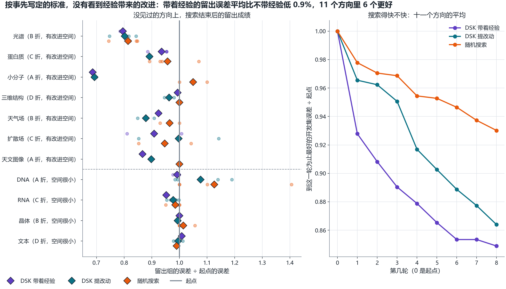

# 把搜索经验带到没见过的方向

[十一个方向的自动研究](autoresearch-eleven.md)每个方向都从零开始，在一个方向上学到的东西带不到下一个。这里把[星流拟合](stream-skill.md)里“把经验留下来”的做法搬过来：让 DSK 把在一部分方向上的搜索记录写成一份搜索经验，锁定后带到它没见过的方向上，同样的轮数，和不带经验的 DSK、同预算的随机搜索比。规则、留出哪几个方向、怎么判定，都在运行前写进[约定文件](search-skill/protocol.md)。

**结论：按事先写定的标准，没有看到经验带来的改进。** 带着经验搜索后，留出误差平均比不带经验的 DSK 低 0.9%，11 个方向里 6 个更好。对 11 个方向重抽样，这个平均差的 95% 区间从低 3.6%到高 1.6%，跨过了零。“有用”要求平均更低、至少 8 个方向更好、区间上界低于零，三条同时满足。

和同预算的随机搜索比，带着经验平均低 7.5%，10 个方向更好，区间从低 14.7%到低 2.3%，三条都满足，带着经验的 DSK 好于随机搜索。不带经验的 DSK 和随机搜索比也是平均低 6.7%、9 个方向更好，所以这个优势来自 DSK 本身，不能算在经验上。



## 分开看

按此前的搜索有没有找到改进，把方向分成两组。每组方向很少，只报数字，不单独下结论。

- **有改进空间的 7 个方向**（光谱、蛋白质、小分子、三维结构、天气场、扩散场、天文图像）：带经验比不带经验平均低 0.2%，4 个方向更好。
- **改进空间很小的 4 个方向**（DNA、RNA、晶体、文本）：带经验比不带经验平均低 2.2%，2 个方向更好。

**搜索得快不快。** 到第 3 轮为止最好的开发集误差，带着经验是起点的 0.890 倍，不带经验 0.951 倍，随机搜索 0.969 倍；到第 8 轮分别是 0.849、0.864、0.930 倍。第 1 轮提的配置在开发集上就好于起点的比例：带着经验 56%，不带经验 28%，随机搜索 19%。这是开发集上的数，搜索过程中反复看过，只说明搜索的快慢，不能当作最后成绩。

## 逐方向

留出组的误差 ÷ 起点的误差，各次运行取平均，小于 1 表示比起点好。

| 方向 | 折 | 改进空间 | 每种方法的运行次数 | 带着经验 | 不带经验 | 随机搜索 | 带经验对不带经验 |
|---|---|---|---:|---:|---:|---:|---|
| 光谱 | B | 有 | 4 | 0.796 | 0.802 | 0.814 | 带经验更好 |
| 蛋白质 | C | 有 | 4 | 0.936 | 0.892 | 0.957 | 不带经验更好 |
| 小分子 | A | 有 | 2 | 0.686 | 0.693 | 1.050 | 带经验更好 |
| 三维结构 | D | 有 | 2 | 0.994 | 0.963 | 1.000 | 不带经验更好 |
| 天气场 | B | 有 | 2 | 0.925 | 0.879 | 0.965 | 不带经验更好 |
| 扩散场 | C | 有 | 2 | 0.909 | 0.997 | 0.947 | 带经验更好 |
| 天文图像 | A | 有 | 2 | 0.867 | 0.898 | 1.000 | 带经验更好 |
| DNA | A | 很小 | 4 | 0.992 | 1.077 | 1.127 | 带经验更好 |
| RNA | C | 很小 | 4 | 0.952 | 0.978 | 0.986 | 带经验更好 |
| 晶体 | B | 很小 | 4 | 1.000 | 0.994 | 1.014 | 不带经验更好 |
| 文本 | D | 很小 | 2 | 1.009 | 0.996 | 0.990 | 不带经验更好 |

## 晶体：经验给了不适用的建议

B 折的经验是从 8 个方向写出来的，里面没有晶胞这种输入。它写的是“晶胞方向无记录，按数值块序列处理并优先试 merge=2”。晶体只有一个晶格 token 和五个原子 token，合并相邻 token 不起作用，合并后的配置等于起点，会被当成做过的配置退回。

- 带着经验的 4 次晶体搜索里，DSK 的提议共被退回 45 次；不带经验的 4 次是 0 次。其余 10 个方向带着经验一共被退回 1 次。
- 其中 2 次没有跑完 8 轮：分别做到第 3、2 轮后，连续多次重提 merge=2 被退回。把退回说明改成写明“merge 在这个方向不起作用”后续跑，仍然如此，于是按已完成的轮次收尾。
- 4 次带着经验的晶体搜索最后选中的都是起点，留出成绩等于起点；只算跑完的 2 次也一样（1.000、1.000）。

这几次没有跑完的运行在右图的曲线里按最后一轮的成绩延续到第 8 轮。经过记在约定文件的补充二、补充三里。

## 四份经验

每一折的经验只用其余方向的存档记录来写，写好后记下 sha256，不再改动。每次带着经验的搜索都在运行记录里存了它用的那份经验的 sha256。

| 折 | 留出的方向 | 字数 | 经验全文 | sha256 开头 |
|---|---|---:|---|---|
| A | 小分子、天文图像、DNA | 1,552 | [skill-A.md](search-skill/skill-A.md) | `b06ce3d07ed4` |
| B | 光谱、天气场、晶体 | 985 | [skill-B.md](search-skill/skill-B.md) | `2215686c6aa0` |
| C | 蛋白质、扩散场、RNA | 1,499 | [skill-C.md](search-skill/skill-C.md) | `05e653ad358e` |
| D | 三维结构、文本 | 1,447 | [skill-D.md](search-skill/skill-D.md) | `3393736e0fad` |

## 读结果时要注意

- **每个方向只有 2 到 4 次运行**，方向只有 11 个。区间来自对方向的重抽样，不包含重新写一遍经验会带来的差别：每一折的经验只写了一次。
- **带着经验的搜索和不带经验的搜索可能选中同一个配置。** 小分子、晶体上，带着经验的每次运行选中的配置都在不带经验的运行里出现过，这时两边的留出误差相同，差别为零。
- **经验只来自 8 或 9 个方向的各 4 次运行。** 一个方向上只见过一两次的现象也可能被写成规则。
- **写经验这一步没有完全照原计划走**：B 折按原来的退回提示连续 12 次都超长，改了退回提示才写成，C 折用了第二轮。经过写在约定文件的补充一节里，发生在任何带经验的搜索开始之前。
- **依据里没有补跑的运行。** 写经验时只用了每个方向的第 1、2 次运行；光谱、蛋白质、DNA、RNA、晶体后来补的第 3、4 次没有进入依据。

## 用量

带着经验的搜索共 32 次，DSK 调用 291 次，约 77 万 token；写四份经验另用约 8 万 token（只计最后成功的那次调用）。[每次运行的留出成绩和逐轮开发集成绩](search-skill/summary.csv)

## 自己运行

在仓库根目录，用存档里锁定的经验搜索一个方向：

```bash
python -m autoresearch.search_skill --field image
```

需要先在自己的进程环境里设置 `SCNET_API_BASE`、`SCNET_API_KEY`、`SCNET_MODEL`。想自己重写一折的经验，用 `--write A --skills out/my-skills`，再加 `--skills out/my-skills` 去搜索。Notebook 第 7.1 小节画出上面的图，并打印当前方向用到的那份经验，不需要密钥。
