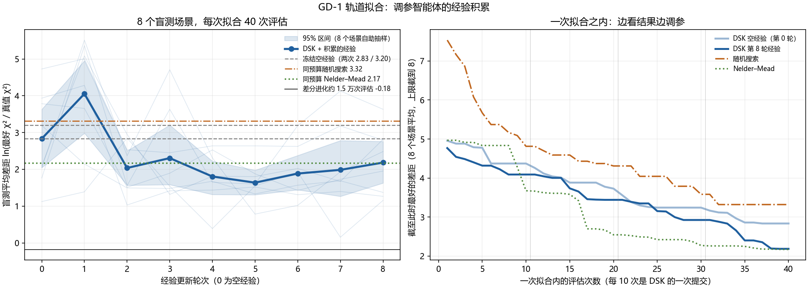

# GD-1 轨道拟合：调参智能体的经验积累

这一节演示两层改进。一次拟合之内，DSK 每次看到上一批参数的 χ²，再提下一批，属于边看结果边调参。多次拟合之间，DSK 把调参经验写成一份短经验（提示目标为 1,500 字，程序接受到 1,800 字），每轮拟合两个新场景后，对照真值改写经验，锁定后到没见过的场景上盲测。

**结论：经验积累有效，但没有一轮比一轮好下去。** 按事先写定的标准，第 6–8 轮的盲测平均差距 2.02，低于空经验的两次测量 2.83 和 3.20。按场景比，8 个场景里有 6 个更好。相比随机搜索（3.32），8 个场景中有 7 个更好。相比 Nelder–Mead（2.17），5 个更好。最好的是第 5 轮（1.64），之后三轮逐渐回升到 2.18。



差距 = ln(找到的最好总 χ² / 真值参数的总 χ²)。0 表示和真值一样好，2.0 大约是真值 χ² 的 7.4 倍。右图把 8 个盲测场景平均，横轴是一次拟合里的第几次评估。

后续复验让 DSK 读完八轮的 16 个训练场景，再改写第八轮经验。在 12 个全新盲测场景中，新版赢旧版 5 次，继续使用第八轮经验。[四批拟合曲线与逐场景比较](stream-skill/revision.md)

## 任务

从 GD-1 星流建模里抽出的轨道拟合，代码在 `autoresearch/stream_fit.py`，只依赖 NumPy。星流轨迹近似为前身天体的轨道，做法同 Koposov et al. (2010)。银河系势是对数晕势 Φ = vc²/2 · ln(R² + z²/q²)，太阳的旋转速度取 vc 加上本动。要拟合 7 个参数：圆速度 vc、晕的扁率 q，以及前身天体在 φ1 = 0 处的 φ2、距离、两个自行和视向速度。

观测是 Koposov et al. (2010) 表 1–4 的 GD-1 测量，取自 Bovy (2016) 公开代码（mwhalo-shape-2016，BSD 许可）中的转录：16 个位置、6 个距离、5 组自行、27 个视向速度，共 59 个数。用大预算差分进化拟合这组真实数据，得到 vc = 216 km/s、q = 0.89、总 χ² = 117。Koposov et al. 给出的是 224 ± 13 km/s 和 0.87。

模拟场景沿用同样的 φ1 位置和误差。真值在真实数据最佳拟合附近均匀抽取，观测值 = 真值轨道 + 高斯噪声。一次轨道评估约 4 毫秒。

## 实验设置

规则在启动前写进[约定文件](stream-skill/protocol.md)，之后没有改动。

- **一次拟合**：4 次提交，每次 10 组参数，共 40 次轨道评估。DSK 看得到观测数据、此前每组参数的 5 类 χ² 和当前经验，温度 0.5。
- **经验更新（8 轮）**：第 r 轮用当前经验拟合 2 个新的训练场景。随后 DSK 读这两个场景的完整记录，包括每次提交的打算、每组参数的 χ²、真值，以及同预算随机搜索的成绩和输赢。它据此改写经验，每条规则要注明依据哪个场景的第几组。新经验锁定后记下 sha256，再到盲测场景上拟合。
- **盲测**：8 个固定场景，数据和成绩从不进入经验更新。
- **基线**：冻结的空经验（第 0 轮测一次，全部轮次结束后再测一次），同预算随机搜索，从允许范围中心出发的同预算 Nelder–Mead。约 15,000 次评估的差分进化只作参照。

## 结果

| | 盲测平均差距 | 95% 区间 |
|---|---:|---:|
| 空经验（第 0 轮） | 2.83 | 2.07–3.67 |
| 第 1 轮 | 4.05 | 3.01–4.98 |
| 第 2 轮 | 2.04 | 1.58–2.51 |
| 第 3 轮 | 2.31 | 1.58–3.21 |
| 第 4 轮 | 1.81 | 1.29–2.25 |
| 第 5 轮 | 1.64 | 1.30–1.99 |
| 第 6 轮 | 1.89 | 1.46–2.37 |
| 第 7 轮 | 1.99 | 1.27–2.79 |
| 第 8 轮 | 2.18 | 1.63–2.78 |
| 空经验复测 | 3.20 | |
| 同预算随机搜索 | 3.32 | |
| 同预算 Nelder–Mead | 2.17 | |
| 差分进化约 1.5 万次评估 | −0.18 | |

区间是对 8 个场景自助抽样得到的。[逐场景成绩](stream-skill/blind.csv)

复核时按同一个盲测场景配对，对 8 个场景有放回抽样 20,000 次。第 6–8 轮平均差距减去基线差距，和两次空经验均值相比为 −1.00（95% 百分位区间 −1.82 至 −0.15），和随机搜索相比为 −1.30（−2.03 至 −0.57），和 Nelder–Mead 相比为 −0.15（−0.64 至 +0.46）。这组事后区间反映场景间差异；对重新运行 DSK 的波动，只做过空经验复测。

**在真实 GD-1 数据上**，空经验和第 8 轮经验各拟合一次，40 次评估后的最好总 χ² 分别是 1,926 和 199，大预算差分进化是 117。每种只跑了一次。

## 经验学到了什么

[第 1 轮](stream-skill/skill-r1.md)到[第 5 轮](stream-skill/skill-r5.md)，经验里逐步固定下来的规则，在新场景上也成立。

- 第一批 10 组参数要分散，覆盖真值常出现的范围，不要从一个固定中心出发。第 2 轮的经验写了一个固定中心，第 3 轮的两个训练场景都输给随机搜索，第 3 轮更新时删掉了这条。
- 一次只动一个参数，多个参数一起大幅改动的组几乎都使 χ² 爆炸。
- 调参顺序：φ2 最敏感，其次是距离和 φ2 方向自行，再次是 φ1 方向自行和视向速度，vc 和 q 最不敏感、放到最后。
- 每批 10 组的分工：第 1 组复制当前最好，其余各组分别对一个参数朝两侧走一小步，留 1 组做大步探索。

**后期回升的一种解释。** 更新提示包含旧经验、历轮训练成绩摘要，以及最近两个训练场景的完整记录。DSK 有时把最近场景中的数值写成通用规则。例如[第 8 轮](stream-skill/skill-r8.md)写了“距离 8.0–8.5 kpc 常为佳”，盲测场景的真实距离在 8.8–10.8 kpc 之间。从第 2 轮起，经验的长度一直在 1,500 到 1,700 字，接近上限，新证据进来，旧的正确规则就被挤掉或改写。单参数试探也可能错过多个轨道参数之间的补偿。这个实验没有单独控制经验长度、训练场景数或联合调参，无法区分这些解释。

## 用量

拟合调用 392 次，经验更新调用 8 次，合计约 150 万 token。核对 98 次拟合的候选记录，96 次各评了 40 组参数，另两次各有一批只交了 9 组，实际各评了 39 组。整批在本机 CPU 上用了约 29 分钟，其中大部分时间在等接口返回。

## 自己运行

从仓库根目录运行离线课堂示例，只需要 NumPy。程序对封存的 80 组参数重新积分轨道，用真实 GD-1 的 59 个测量值计算每一批结束时的最低总 χ²。

```bash
python -m autoresearch.replay_stream
```

| 开始拟合时的经验 | 10 次评估 | 20 次 | 30 次 | 40 次 |
|---|---:|---:|---:|---:|
| 空经验 | 2,761.98 | 2,210.90 | 2,044.27 | 1,925.86 |
| 第 8 轮经验 | 382.22 | 354.26 | 295.63 | 199.01 |

两行各来自一次 DSK 实验。读表时可把同一行从左到右的参数改进，和同一列里两套经验的差异分开讨论。[封存的候选参数](stream-skill/real-candidates.csv)

用自己的 DSK 接口从头生成参数和更新经验，运行

```bash
python -m autoresearch.stream_skill --out out/stream-skill
```

需要在自己的进程环境里设置 `SCNET_API_BASE`、`SCNET_API_KEY`、`SCNET_MODEL`，密钥不写进任何文件。每次拟合的完整记录存在 `out/stream-skill/fits/`，每轮的经验存成 `skill-r*.md`，中断后用同一命令接着跑，已完成的拟合不会重做。只想看轨道模型，可以直接调用 `autoresearch.stream_fit.chi2`，它不需要接口。
