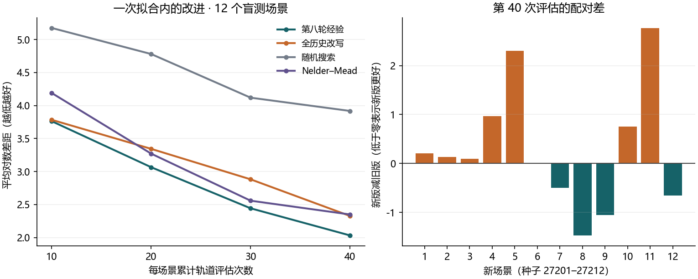

# 读完八轮训练记录，星流拟合经验会更好吗？

**本轮保留第八轮经验。** DSK 把早期和近期共 16 个训练场景的证据合在一起，改写了一份调参经验。它在 6 个新开发场景中赢了旧版 1 次，在另 12 个盲测场景中赢了 5 次。两道预设门槛都没有通过。

## 同一套轨道模型，两层改进

在一次拟合内，DSK 每批看到已试参数以及五类观测的 χ²，再提下一批参数。每次拟合的预算为四批各十条轨道。跨拟合更新经验时，DSK 看到旧经验、每个训练场景的真值、各批最好候选和单参数或联合试探的输赢次数。候选经验锁定后才给它新场景。两套经验用相同的模型、提示、温度和积分预算。复验使用 GD-1 类模拟观测，真值在真实数据拟合附近抽取。

改写删掉了“距离 8.0–8.5 kpc 常为佳”的偏好，要求按当前观测和试探结果选方向。同时，它仍给出了固定的初始范围，并建议当单参数调整让两个观测分量此消彼长时，留一两组参数做联合调整。每组新观测的拟合只运行一次。[第八轮经验](skill-r8.md) · [封存的改写正文](revision-skill.md) · [提供给 DSK 的训练证据](revision-evidence.json)

## 同预算盲测

指标为 ln(迄今最低总 χ² / 真值参数的总 χ²)，按场景取平均，越低越好。横向读表能看到一次拟合内的改进；纵向比较同一列，可以检验经验更新的效果。

| 方法 | 10 次积分 | 20 次 | 30 次 | 40 次 |
|---|---:|---:|---:|---:|
| 第八轮经验 | 3.763 | 3.066 | 2.443 | 2.031 |
| 读完 16 个场景后改写 | 3.784 | 3.344 | 2.882 | 2.326 |
| 均匀随机搜索 | 5.176 | 4.781 | 4.120 | 3.918 |
| Nelder–Mead | 4.190 | 3.271 | 2.558 | 2.349 |



开发集上，新版减旧版的平均差为 +0.532，仅 1/6 个场景改善，低于采纳所需的 4/6。按原约定，两个版本仍各自在盲测场景上运行一次。下表的区间按场景配对重采样；每个场景只有一次 DSK 运行，区间只描述这 12 个场景的差异。

| 40 次积分时的比较 | 前者赢的场景数 | 前者减后者的平均差 | 配对 95% 区间 |
|---|---:|---:|---:|
| 新版与第八轮经验 | 5/12 | +0.295 | [−0.363, +0.991] |
| 新版与随机搜索 | 10/12 | −1.592 | [−2.273, −0.833] |
| 新版与 Nelder–Mead | 7/12 | −0.023 | [−0.759, +0.816] |
| 第八轮经验与随机搜索 | 11/12 | −1.887 | [−2.430, −1.315] |
| 第八轮经验与 Nelder–Mead | 8/12 | −0.318 | [−0.854, +0.272] |
| 随机搜索与 Nelder–Mead | 2/12 | +1.570 | [+0.824, +2.310] |

两套经验在前 10 次积分后的平均差只有 0.021，到第 30 次扩大为 0.439。两版在盲测中各评了 480 条轨道，其中旧版有 54 次重复参数，新版有 55 次。重复数接近。新版提到更宽的初始范围，但实际第一批提议的平均跨度，在距离上从 2.38 缩到 1.83 kpc，在晕扁率上从 0.12 缩到 0.03。单靠这次对照，还不能把差异归因于初值、联合调参或提议的随机性。[逐场景、逐批成绩](revision-blind.csv) · [评分前的实验约定](revision-protocol.md)

## 复现

仓库根目录执行以下命令可重新生成并验证一份新经验。DSK 从进程环境变量 `SCNET_API_BASE`、`SCNET_API_KEY`、`SCNET_MODEL` 读取接口配置，轨道积分在本地 CPU 上运行。程序默认读取随仓库附带的 16 个训练场景摘要。重用同一输出目录可接续同一轮实验，换空目录可独立重跑。DSK 的实时提议会波动。

```bash
python -m autoresearch.stream_revision --out out/gd1-revision
```

这轮使用 DeepSeek-V4.1-Flash-1017，拟合调用 144 次，改写调用 2 次。复核时从 36 份拟合记录中的 1,440 组参数重新积分，逐组核对了五项 χ²。原版真实 GD-1 拟合可用 `python -m autoresearch.replay_stream` 在 CPU 上离线重放。
