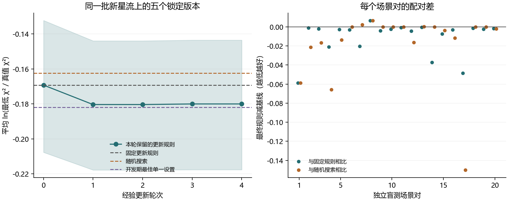

# GD-1 星流拟合：智能体能否学会改进自己的调参规则？

DSK 改写了生成下一次试验的规则。在 20 对新模拟星流上，最终规则比原固定规则赢 19 对，最低 χ² 的几何平均降幅为 1.07%。对同预算随机搜索赢了 12 对，另有 1 对持平。实验预定两个主对照都至少赢 14 对、对数差至少降低 0.02，且配对区间的上界低于零。本轮未通过这项联合判据。

## 每一层在学什么

单次拟合从先验盒中心出发，根据 59 个观测的带符号残差，用阻尼 Gauss–Newton 法更新七个轨道参数。每种设置占 40 次轨道评估。新数值工具对本轮所有方法开放；此前文字经验实验只给 DSK 五项 χ²，两次实验的绝对分数应分开读。

调参器能改三个数：阻尼、最大步幅、差分步长。每对星流都从相同设置开始，在第一条星流上试起点和四个候选，选定设置后去拟合第二条星流。固定规则、随机搜索和 DSK 学到的规则各用相当于 200 次轨道评估的选参预算，加上 40 次独立评分。所有方法共用的确定性计算可以缓存，重复利用缓存仍按完整预算计数。

跨任务的改进发生在这四条候选生成指令上。DSK 看已执行试验及旧规则的反馈，每轮提出一份可执行的新规则。候选胜过当前规则才在下轮使用。四轮开发结束后锁定五个版本，在相同的 20 对新星流上一并评分。[评分前的实验约定](updater-protocol.md) · [DSK 原始提议与理由](updater-proposals.json)

## 哪一步真的有收益

| 轮次 | DSK 提议与开发决定 | 对当时规则的开发平均差 | 锁定版本盲测平均对数差距 |
|---|---|---:|---:|
| 0 | 起点，固定四条指令 | — | −0.16929 |
| 1 | 去掉增阻尼的试探，最后联合降低阻尼并增大步幅，采纳 | −0.01555 | −0.18041 |
| 2 | 提议与现行规则相同，沿用 | 0 | −0.18041 |
| 3 | 最后一步再同步缩小差分步长，采纳 | −0.00566 | −0.18006 |
| 4 | 再次提出同一规则，沿用 | 0 | −0.18006 |

分数是 ln(拟合得到的最低 χ² / 生成模拟数据的真值参数的 χ²)，越低越好。观测带噪，拟合参数可以比真值更贴合这一份观测，分数允许为负。第 1 轮的联合移动改善了盲测表现。第 3 轮的改动虽在开发上通过，盲测平均比第 1 轮略高 0.00035，因此没有观察到两次递进的独立收益。



| 最终规则的对照 | 胜 / 平 / 负 | χ² 几何平均相对变化 | 平均对数差的配对 95% 区间 |
|---|---:|---:|---:|
| 固定更新规则 | 19 / 0 / 1 | −1.07% | [−0.0190, −0.0040] |
| 同预算随机搜索 | 12 / 1 / 7 | −1.74% | [−0.0355, −0.0046] |
| 开发期最佳单一设置 | 3 / 0 / 17 | +0.19% | [+0.00008, +0.00485] |
| 原始设置 | 19 / 0 / 1 | −3.08% | [−0.0497, −0.0165] |

单一设置在开发期实际试过的 50 组中用另三条开发星流选出，取阻尼 10⁻⁶、最大步幅 1、差分步长 0.001。它对每个盲测任务只做一次 40 次评估的拟合。这说明对于本实验同分布的星流，离线选好设置很有竞争力。20 个场景对估计的是锁定规则的迁移表现；DSK 的四轮提议过程只运行了一次。[逐场景设置与成绩](updater-blind.csv)

## 还剩多少可改善空间

主盲测结束后，又取独立的 12 对开发星流作诊断。每对的评分星流分别从先验盒中心和已有最好解出发，用高预算的有界非线性最小二乘细化。两种起点所得 χ² 的最大绝对对数差约 3.2 × 10⁻⁹。相对固定更新规则，还能降低约 2.13%；相对最终规则，只再降低约 0.083%；相对最佳单一设置，只再降低约 0.057%（均为几何平均）。这是两个起点实测的数值参考。这个结果解释了为何只看拟合 χ² 时，继续修改步长和阻尼的余量很小；它不检验轨道参数恢复精度或模型失配。[高预算诊断逐场景回执](updater-headroom.csv)

## 本地复现

在仓库根目录运行以下命令。离线模式读入封存的四份 DSK 提议，在 CPU 上重新积分、重做采纳判断并生成 `blind.csv` 和 `verdict.json`。

```bash
python -m autoresearch.stream_updater --out out/gd1-updater-replay --replay
```

要让 DSK 重新提议，设置进程环境变量 `SCNET_API_BASE`、`SCNET_API_KEY`、`SCNET_MODEL`，用空的输出目录运行 `python -m autoresearch.stream_updater --out out/gd1-updater-live`。本轮使用 DeepSeek-V4.1-Flash-1017，四份提议的原文随仓库保存。
