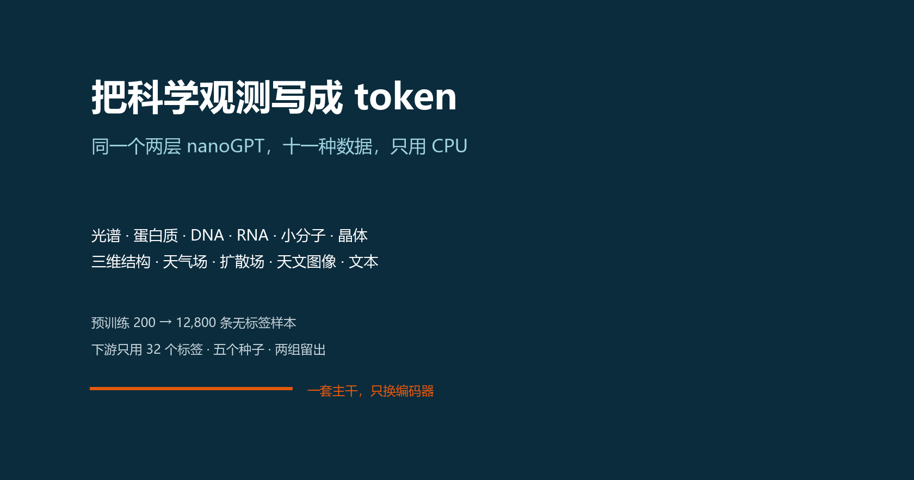
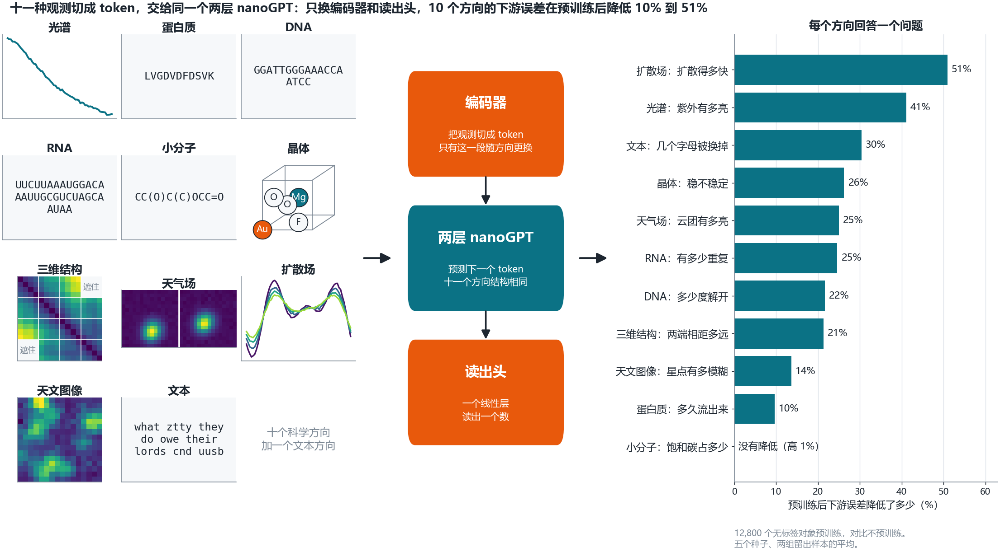
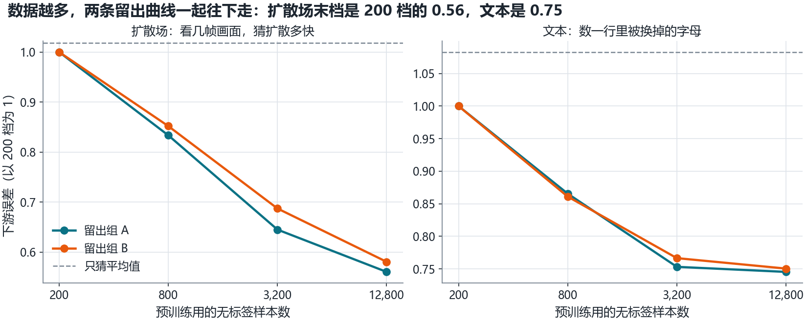
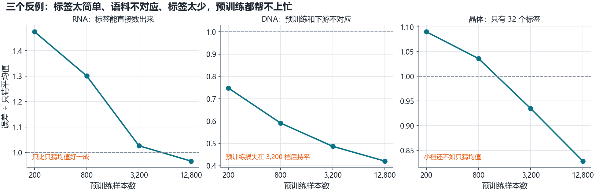

# 一个两层小模型，怎么同时读懂光谱、氨基酸和云图？

先说结论：把不同的科学观测都写成一串 token，交给同一个两层 nanoGPT，只换入口的编码器和出口的读出头，就能让模型在十一种数据上跑通同一套训练流程。预训练数据从 200 条加到 12,800 条，十一个方向的下游误差都往下走。

这不是一篇论文，是一套可以整本跑完的课堂材料。全部 CPU，默认方向三分钟，不需要显卡，也不需要下载模型权重。

## 01 先把观测写成一句话

语言模型读的是一串 token。它做的事情很朴素：看前面的 token，猜下一个。

科学数据看起来完全不像文字，但也能这样切开。光谱每 4 个相邻波长算一个 token；蛋白质每个氨基酸算一个；晶体把晶格矩阵放第一个，之后每个原子一个；星场图像每个 4×4 像素块算一个。数字类 token 先做一次线性投影，符号类 token 查词表，两者最后都变成 32 维的向量。



图里左边是十一种输入，中间是同一个两层 nanoGPT，右边是每个方向要回答的一个问题，括号里是 12,800 条预训练之后，下游误差比不预训练低了多少。

## 02 只换入口，主干不动

这件事在代码里是可以核对的。模型的构造函数只接收两个和方向有关的东西：编码器和序列长度。位置嵌入、两层注意力、最后的 LayerNorm，全部来自仓库里的 nanoGPT 实现。

方向之间的差别只有三处：编码器把观测切成什么 token，预训练预测什么（符号用交叉熵，数值块用均方误差），以及最后那个线性读出。十一个方向共用三种编码器：符号序列、数值块、晶胞。

这也是这套材料想讲的核心：科学基座模型的“基座”可以很小，小到两层、32 维；统一性来自 token 化方式，能力来自数据和预训练目标。

## 03 一个实验：数据越多，下游越好吗

每个方向都用 200、800、3,200、12,800 条无标签数据各预训练一次，五个随机种子。然后只用 32 个标签训练读出，在两组没参加训练的留出样本上测误差。

两条基线用来判断这个误差算不算好：一条是“只猜平均值”，不用任何模型；一条是“不预训练”，同样的模型和标签，只是主干没预训练过。



扩散场的误差降到 200 档的 0.56，文本降到 0.75。十一个方向在两组留出样本上都逐档下降，端点降幅从 14% 到 52% 不等。

有意思的是幅度差别很大。扩散场、光谱这类输入和标签关系直接的，降得多；蛋白质、天文图像这类标签本身噪声大的，降得少。这比“全都很好”更值得讲。

## 04 三个反例，比成功案例更有意思

十一个方向里有三个，预训练几乎帮不上忙。我们把它们留在表里，因为失败的原因很具体。



**RNA：标签太简单。** 下游任务是数片段里三核苷酸的组合有多复杂，这个数可以直接从序列算出来。不预训练的模型取个平均就能读出大半，所以末档只比只猜平均值好一成。它检验的是模型有没有保留局部组成信息，跟 RNA 的结构和功能没有关系。

**DNA：语料和下游不对应。** 预训练读的是酵母基因组片段，下游是人工设计的 14 到 18 个碱基的发夹。基因组片段到 3,200 条以后，预训练损失基本不再下降，下游靠微调还在变好。换用同一实验里的两万多条发夹做预训练，又因为骨架种类太少，800 条就学完了，下游反而不如不预训练。

**晶体：标签太少。** 只有 32 个标签时，不预训练的模型怎么读出都比只猜平均值差。200、800 两档也不如只猜平均值，到 3,200 档才超过。标签数量决定了预训练有没有发挥的空间。

这三条合起来是一句话：预训练不是万能的，标签的难度、数量和它跟数据的对应关系，决定了预训练能帮多少。

## 05 让程序自己改设置

课程还往前推了一步：把“改设置、跑实验、看结果、再改”交给程序。主干锁死，可以改的是 token 怎么合并、预训练预测什么、步数和学习率、读出方式。每一轮在开发集上打分，最好的配置最后才在留出组上评一次。

十一个方向各跑 8 轮，和大语言模型提改动、同预算随机搜索两种方式比较。结果是 4 个方向好于随机搜索，5 个分不出高下，2 个没跑赢。我们还试过让模型把搜索经验写成文档，带到没见过的方向上，结果没有看到改进，也照实写在仓库里。

这一段的价值不在“自动化多强”，而在流程：规则先写死，结果好坏都留档。

## 06 怎么自己跑

需要 Python 3.10 以上和 Git，只用 CPU。三分钟能跑完一个方向：

```
git clone https://github.com/Yu-Yang-Li/nanoSciGPT.git
cd nanoSciGPT
python -m pip install torch --index-url https://download.pytorch.org/whl/cpu
python -m pip install -e .
python -m nanoscigpt.quickstart
```

最后一条会打印三档预训练的下游误差，并画一张图。想换方向，在命令后面加名字，比如 `protein`。

想一步一步看数据、看 token、看模型结构，打开 `notebooks/eleven_fields.ipynb`。九节加一节练习，每一节写着本节目标和检查点，默认方向整本跑完约半分钟到三分钟。魔搭 Notebook、JupyterLab、Colab 都能直接跑：把仓库克隆到一个工作目录，打开笔记本，第 0 节会自己补装缺少的依赖。

## 07 边界

这套材料的目标是展示教学可能性，不是各领域的真实基准。十一个方向里有五个是公式生成的理想化模拟：光谱是两个黑体的混合，扩散场是扩散方程的解析解，天文图像是高斯星像，三维结构是随机高分子链，天气场是两团亮斑的序列。它们用来隔离变量、控制难度和 CPU 用时。

另外六个用真实数据：蛋白质的色谱保留时间、DNA 发夹的熔解温度、Rfam 里的 rRNA 片段、QM9 分子、Matbench 钙钛矿的形成能、莎士比亚台词。每个方向的标签定义、单位、数据出处和适用范围，都写在仓库的 `data/eleven/SOURCES.md` 里。

讲课时把这句话带上就够了：这是展示方法的理想化设置，真实数据上的精度要另做验证。

## 最后

仓库：https://github.com/Yu-Yang-Li/nanoSciGPT

十一个方向的完整数字、五个种子、两组留出，以及每一次实验的规则和偏离，都在 `docs/pretraining-scale/shared-checkpoints/` 里。代码是开源的，欢迎换成你自己的方向，看看曲线还成不成立。

